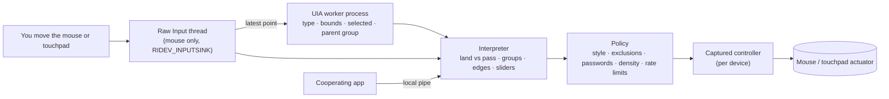

# Haptics Everywhere

**Feel the things you can *do* in Windows: buttons, tabs, ribbons, menus, sliders, the taskbar. In any app, with no
changes to those apps.**

The Surface Mouse (2nd Edition) and Surface haptic touchpads can buzz, but only where an app explicitly asks.
Haptics Everywhere is a small background app that *observes* your pointer and the UI under it (through Windows
accessibility) and adds a light, meaningful tick when you land on something actionable. A detent tells you that you
moved to a new group or choice; an edge tells you that you reached the end of a strip.

> **It never moves, clicks, or focuses anything, never reads the keyboard, and never reads names or text.** It's passive:
> mouse input plus read-only UI structure. Nothing leaves your PC. See [`docs/PRIVACY_AND_THREAT_MODEL.md`](docs/PRIVACY_AND_THREAT_MODEL.md).

## Get it

Download `HapticsEverywhere-<version>-win-arm64.zip` (Snapdragon Surfaces) or `-win-x64.zip` from
[**Releases**](https://github.com/shanselman/haptic-outside-labs/releases). It's self-contained, so no .NET install is
needed. Unzip it, then:

| Run | What it is |
|---|---|
| `haptics-tray.exe` | **The app.** Starts On. Wiggle your haptic mouse and/or touchpad over the little box once, then use Windows. Right-click the tray icon for Style, Intensity, Exclude app, Status, Off. |
| `haptics-lab.exe` | **The Showcase.** Feel each sensation, try it on real controls, see *why* each tick happened (or didn't), and blind-compare the styles. Also holds the research lab. |

In the Showcase, follow **Start here**: move each haptic device over the window, click **Feel it** next to Land,
then explore the sample controls or another app while keeping the Showcase open. The status line tells you when
a controller is captured. **Engine activity** explains decisions, not proof that a pulse was felt; Inspector shows
output details. Without a haptic device, you can still explore the controls and Inspector.

Requirements: Windows 11 with the haptics API (build 26100+, Universal API Contract 19; built and tested on 28000) and a
haptic mouse or touchpad.

## What you feel

Four sensations, one meaning each, so they become a language rather than a buzz:

| Sensation | Waveform | Means | Examples |
|---|---|---|---|
| **Land** | Hover | You landed on something you can do | buttons, menu commands, checkboxes, links, combo boxes, taskbar buttons |
| **Land · big** | Click | A large target | the big buttons in Office ribbons |
| **Detent** | Step | A new choice or region | entering a toolbar, ribbon group, menu or tab strip; moving to another tab or option; slider ticks while dragging |
| **Edge** | Collide | End of the line | sliding off the end of a toolbar or tab strip; a slider reaching its limit |

**Choosy on purpose:**
- **Landing, not passing.** Flying across a toolbar is silent; slowing or stopping on a button ticks. The threshold
  learns from how fast *you* move just before you click.
- **Silent on purpose:** windows, panes, text, list, tree and grid rows (files, emails), the tab you're already on,
  disabled controls, tiny targets, links inside running text, password fields, password managers, and sign-in screens.
- **Busy apps back off:** if an app produces lots of lands quickly, lands pause briefly and structure (detents, edges) keeps
  working. Browsers, chat and IDEs have lower limits; Office ribbons get softer lands so group detents stand out.
- **No faked outcomes.** We can't know whether a drop or save worked, so Success, Error and Align come only from apps
  that tell us (see *Cooperating apps*).

**Styles:**
- **Quiet:** structure only (detents and edges).
- **Focused** (default): Quiet plus a tick when you land on a control.
- **Everything:** every crossing, dense; good for demos.

Intensity runs Low → Max. Touchpads get a boost, because they feel lighter than mice at the same strength.

## How it works (and why the one-time "prime")



Windows' `InputHapticsManager` only gives a haptic controller to a thread whose *own window* just got input from the
device. A background app never does. We measured this with blinded, felt tests: calling the API from the thread
receiving background input never got a controller (0 of 288 samples). **What works:** capture the device's
`SimpleHapticsController` once, while you wiggle it over our window, then drive it from the background (felt 6/6 vs
0/6 silent controls).

That's the "prime". The tray re-primes silently whenever you move over its menu.
[`samples/MinimalBackgroundHaptics`](samples/MinimalBackgroundHaptics/Program.cs) shows the whole trick in ~150 lines.

## Cooperating apps

Apps know things we can't infer, like "a snap guide appeared" or "the drop was accepted". Any app running as the same
user can send a haptic over the local pipe `HapticsEverywhere`. It still goes through the same policy (rate limits,
exclusions):

```powershell
$p = [System.IO.Pipes.NamedPipeClientStream]::new('.', 'HapticsEverywhere', 'Out'); $p.Connect(500)
$w = [System.IO.StreamWriter]::new($p); $w.WriteLine('{"waveform":"Align"}'); $w.Flush(); $p.Dispose()
```

Or run `haptics-lab coop-send Success`. Valid waveforms: Hover, Click, Step, Collide, Align, Success, Error, Grow,
Press, Release (whatever your device supports).

## Build from source

```powershell
git clone https://github.com/shanselman/haptic-outside-labs
cd haptic-outside-labs
dotnet test                      # 79 tests: vocabulary rules, golden traces, policy, safety scans, UIA worker
.\scripts\run-tray.ps1           # the app
.\scripts\run-lab.ps1            # the Showcase
.\scripts\publish.ps1            # self-contained zips for win-arm64 and win-x64
```

.NET 10 SDK, Windows only. Projects target `net10.0-windows10.0.26100.0` with the 28000 SDK projection (ADR 0005).

## The research behind it

This started as an evidence-first lab: the platform question ("can a normal background app buzz the mouse while
another app is in front?") was genuinely unknown, so the repo was built to *prove* it rather than assume it. It
used blinded pulse/no-pulse trials, Fisher exact tests, and an evidence ledger that never counts an API returning `true`
as a buzz. The answer is **yes, via a captured controller**:

| Gate | Result (Surface Laptop 8, Windows 28000, ARM64, Surface Mouse 2nd Edition) |
|---|---|
| Foreground actuation (EXP-010) | **PHYSICAL PASS**: 12/12 felt vs 0/6 silent controls |
| Background actuation (EXP-020) | **PHYSICAL PASS** via captured controller (R3a, R3b: 6/6 vs 0/6 each); plain background route R2 **FAIL** |
| UIA semantics (EXP-040/043) | 23/23 fixture controls, p95 ≈ 4–6 ms; hung providers cut off in ≈ 240 ms |

The lab is still there (the Showcase's **Lab** tab, `haptics-lab run …`) for checking new devices and builds, but you
don't need it to use the app. Start with [`docs/EVIDENCE_LEDGER.md`](docs/EVIDENCE_LEDGER.md),
[`docs/DESIGN_NOTES.md`](docs/DESIGN_NOTES.md) and the operator runbook
[`docs/TESTING_WITH_SURFACE_MOUSE.md`](docs/TESTING_WITH_SURFACE_MOUSE.md).

## Repository map

```text
src/Haptics.Core        vocabulary rules (interpreter + policy), evidence model, golden-trace replay, API scanner
src/Haptics.Windows     raw input, guarded haptics routes, per-device controller bank, UIA worker, cooperative pipe
src/Haptics.Tray        haptics-tray.exe — the app
src/Haptics.Lab         haptics-lab.exe — Showcase (+ Inspector, Lab tab, CLI, experiments, fixtures)
samples/                MinimalBackgroundHaptics — the core trick in ~150 lines
tests/                  Core tests (vocabulary, policy, 13 golden traces) + Windows tests (safety scans, worker, tray)
docs/                   design notes, evidence ledger, hypotheses, research, privacy/threat model, ADRs, SPEC
```

## Docs

- [`docs/DESIGN_NOTES.md`](docs/DESIGN_NOTES.md): decisions, trade-offs, the haptic vocabulary
- [`docs/EVIDENCE_LEDGER.md`](docs/EVIDENCE_LEDGER.md): what has been measured, where, and with which commit
- [`docs/PRIVACY_AND_THREAT_MODEL.md`](docs/PRIVACY_AND_THREAT_MODEL.md): what's observed, hard constraints, harms
- [`docs/RESEARCH.md`](docs/RESEARCH.md): verified API surface and observed platform behaviour
- [`docs/TEST_MATRIX.md`](docs/TEST_MATRIX.md): what each test layer can and cannot prove
- [`docs/TESTING_WITH_SURFACE_MOUSE.md`](docs/TESTING_WITH_SURFACE_MOUSE.md): operator runbook for the physical experiments
- [`docs/RELEASING.md`](docs/RELEASING.md): signing secrets and cutting a signed release
- [`docs/ADR/`](docs/ADR), [`docs/HYPOTHESES.yaml`](docs/HYPOTHESES.yaml), [`docs/SPEC.md`](docs/SPEC.md)

## What's next

1. **Controller lifetime (EXP-082):** does a captured controller survive idle, sleep/resume, and Bluetooth re-pair?
2. **Blind style comparison (EXP-090):** Showcase → *Compare styles*. Which style do people keep on?
3. **Native double-buzz A/B (EXP-075)** against Snap and PowerPoint; **latency/CPU in real apps (EXP-080)**.
4. Per-app profiles tuned by feel; more cooperating apps.
