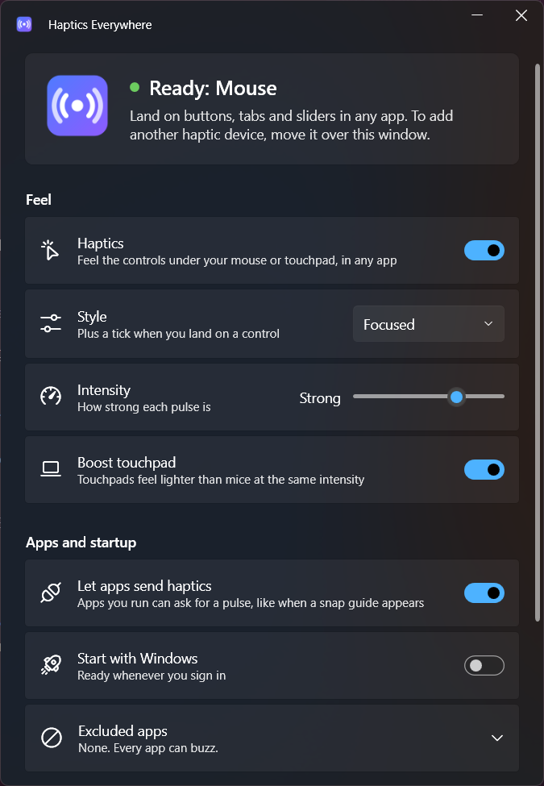
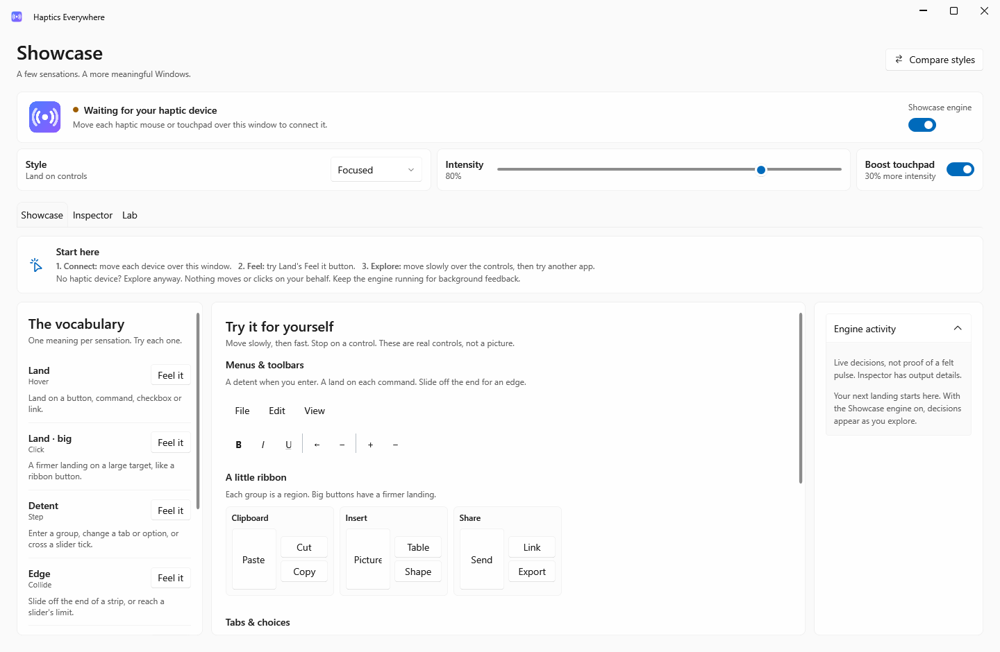
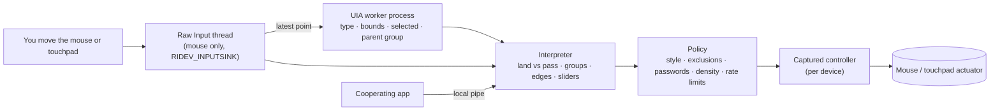

# Haptics Everywhere

**Feel the things you can *do* in Windows: buttons, tabs, ribbons, menus and sliders. In any app, with no
changes to those apps.**

<p align="center">
  
</p>

The Surface Mouse (2nd Edition) and Surface haptic touchpads can buzz, but only where an app explicitly asks.
Haptics Everywhere is a small background app that *observes* your pointer and the UI under it (through Windows
accessibility) and adds a light, meaningful tick when you land on something actionable. A detent tells you that you
changed a toggle or crossed a slider tick; an edge tells you that you reached a slider endpoint.

> **It never moves, clicks, or focuses anything, never reads the keyboard, and never reads names or text.** It's passive:
> mouse input plus read-only UI structure. Nothing leaves your PC. See [`docs/PRIVACY_AND_THREAT_MODEL.md`](docs/PRIVACY_AND_THREAT_MODEL.md).

## Get it

**New in 0.6:** a **Visual demo** in the Showcase that shows a ripple wherever a haptic would play (no haptic
hardware needed), an optional **Show ripples** for the tray so screen recordings show what you feel, and taskbar
buttons that tick reliably instead of eventually silencing everything. This remains a proof-of-concept tester
build; the [validation checklist](docs/AUTOMATIC_PRIMING_TEST_PLAN.md) records the known results and remaining checks.

Download `HapticsEverywhere-<version>-win-arm64.zip` (Snapdragon Surfaces) or `-win-x64.zip` from
[**Releases**](https://github.com/shanselman/haptic-outside-labs/releases). It's self-contained, so no .NET install is
needed. Unzip it, then:

| Run | What it is |
|---|---|
| `haptics-tray.exe` | **The app.** Starts On and tries experimental automatic device lookup. If a controller is found, use Windows without a priming window. Otherwise Settings opens: move your haptic device over it once. Click the tray icon for settings (Style, Intensity, excluded apps, start with Windows); right-click it for the quick menu. |
| `haptics-lab.exe` | **The Showcase.** Feel each sensation, try it on real controls, see *why* each tick happened (or didn't), and blind-compare the styles. Its header has an observe-only **Visual demo** toggle that ripples at the pointer wherever a cue would play, for demos without haptic hardware. Also holds the research lab. |

Stable numeric-tag releases may also include an **experimental `.msixbundle` installer** covering both ARM64 and x64.
It adds Start menu entries and a standard Installed apps uninstall; the ZIPs remain the portable option. Read the
[MSIX limitations and validation checklist](docs/RELEASING.md#optional-msix-bundle) first, especially for
**Start with Windows**. Automatic updates are not configured.

In the Showcase, follow **Start here**: move each haptic device over the window, click **Feel it** next to Land,
then explore the sample controls or another app while keeping the Showcase open. The status card tells you when
a controller is captured. **Engine activity** explains decisions, not proof that a pulse was felt; Inspector shows
output details. Without a haptic device, you can still explore the controls and Inspector.
For a presentation without haptic hardware, turn on **Visual demo** (top right, next to **Showcase engine**). It
observes real controls in any app and shows a brief, click-through ripple at the pointer wherever policy would play
a cue, without sending any haptics; it also works while another app (such as the tray) owns physical output. The
**Stage** tab shows the same cues full-size. The tray has a matching **Show ripples** option (quick menu or
Settings, off by default) that draws the same ripple alongside real haptics, handy for screen recordings. These
visuals demonstrate intent, not physical output or a pulse someone felt.

The Showcase shares the tray's Windows 11 / Fluent design, follows the system's light or dark theme, and scales
with your display. **Showcase**, **Inspector**, and the optional **Lab** are keyboard-accessible tabs. On narrower
windows, expand **Engine activity** below the demos. If the tray is already running, the Showcase pauses its own
engine to avoid duplicate feedback; quit the tray before enabling this engine or starting a blind comparison.

<p align="center">
  
</p>

Requirements: Windows 11 with the haptics API (build 26100+, Universal API Contract 19; built and tested on 28000) and a
haptic mouse or touchpad.

### Experimental single-pen support

The tray has an **Experimental single pen** switch in Settings, off by default. Turn it on and hover or glide
your haptic pen over Settings once; **Ready** lists `Pen` when its controller is captured. Use only one pen:
Windows exposes a pen-input signature here, not the identity of the individual pen. Toggle the option off/on
to select and prime another pen. Turning Haptics Off or removing any input device clears the pen route and
requires priming again. A lost pen controller also stays silent until primed again.

Pen feedback uses the existing interpreter, policy and output queue, but a separate manually primed controller:
pen events cannot select the mouse/touchpad, and touch-promoted events remain silent. Unsupported discrete pen
sensations fall back to the pen's supported Click waveform, recorded as a fallback; mouse/touchpad behavior is
unchanged. This is not exact per-pen routing or a validated multiple-pen mode. The Showcase does not opt into it.
Background delivery and coexistence need operator checks on each setup.

To establish a pen's foreground baseline, quit other Haptics Everywhere instances and run
`haptics-lab run EXP-010 --target pen`. Use only the pen over the dark pad and check the live
`device=Pen` / `controller=present` status before starting the randomized pulse/no-pulse trials.
Wrong-type or missing controllers cannot send, and those trials cannot establish a baseline.
Leave the native-haptics confirmation unchecked unless you have actually felt the pen's native tactile feedback.

One operator run on a Surface Pro 12in 2nd Ed Snapdragon felt 6/6 Click pulses vs 0/6 silent controls
([evidence ledger](docs/EVIDENCE_LEDGER.md)); the exact pen model and stable controller identity were not established.
This tests the current-thread acquisition route, not every possible Windows pen API. A missing controller is not
proof that the pen cannot vibrate. `EXP-030 --target pen` records passive input-source counts.
`EXP-020 --target pen` compares cached-controller and temporary-override background output using one explicitly
primed pen and pen-class signatures, not per-pen identity. Both routes passed one blinded Click test at intensity 1.0;
this does not validate integrated tray feedback or distinguish hover from screen contact.
Using the tray is not a substitute for a blinded background trial.

An unblinded operator check felt pen hover feedback in the tray's own Settings window (last recorded output:
Click at 0.80), but reported skipped cues and no feedback in other apps. Background tray reliability remains
unresolved despite the separate successful background route trial. Do not rely on this experimental mode for
consistent cross-app pen feedback yet. Settings Details exposes input class, output intensity/fallback and routing
notes; API acceptance is not evidence that a pulse was felt.

## What you feel

Three automatic sensations, plus an explicit Click preview:

| Sensation | Waveform | Means | Examples |
|---|---|---|---|
| **Land** | Hover | You landed on something you can do | tabs, buttons, menu commands, links, combo boxes, slider thumbs; Everything also adds radio options and group entry |
| **Click preview** | Click | Explicit waveform preview, not automatic landing feedback | Showcase's Click preview; all automatic button landings use Hover |
| **Detent** | Step | A state tick | click-confirmed checkbox/toggle changes; slider ticks while dragging |
| **Edge** | Collide | A slider endpoint | a dragged slider reaching its minimum or maximum; strip exits stay silent |

**Choosy on purpose:**
- **Landing, not passing.** Dwell is 30 ms for small controls and 50 ms for tabs/large controls in every style; fly-bys are silent.
- **Silent on purpose:** windows, panes, text, list, tree and grid rows (files, emails), the tab you're already on,
  disabled controls, tiny targets, password fields, password managers, and sign-in screens. Inline links hover
  in all styles; Focused also accepts conservatively filtered text-sized links inside Groups. Other links
  and dropdown options are Everything-only. Taskbar buttons are also Everything-only.
- **No app-specific thinning by default:** global rate limits and same-target cooldown still apply.
- **No faked outcomes.** We can't know whether a drop or save worked, so Success, Error and Align come only from apps
  that tell us (see *Cooperating apps*).

**Styles:**
| Event | Quiet | Focused | Everything |
|---|---|---|---|
| Unselected tabs and inline text links | Hover | Hover | Hover |
| Text-sized links inside Groups | - | Hover | Hover |
| Dropdown pickers and explicit menu/SplitButton roles | - | Hover | Hover |
| Slider thumb hover | - | Hover | Hover |
| Slider drag detents/endpoints | Step/Collide | Step/Collide | Step/Collide |
| Click-confirmed checkbox/toggle changes | - | Step | Step |
| Other links, picker options, ordinary Buttons, toggle/radio hover, open menu choices, group entry | - | - | Hover |
| Primary/secondary taskbar buttons | - | - | Hover |

Focused uses explicit UIA navigation/menu roles; a generic Button does not qualify from dropdown capability,
class name, or geometry. Everything retains broader Button and option hover coverage.

Everything uses the existing dense ceiling of 25 pulses per second and a 40 ms reentry cooldown in both tray and
Showcase. These are ceilings, not continuous feedback; the intensity slider still controls strength.
The separate **More is better** setting is off by default and applies the same dense limits to Quiet/Focused.
Neither bypasses dwell, the selected style, Off, password protections or app exclusions.

Intensity runs Low → Max. Touchpads get a boost, because they feel lighter than mice at the same strength.

### Focused controls

Close hover is removed from Focused pending a replacement implementation. It is off in local tray settings and
Showcase; native caption probing stays disabled. Taskbar buttons are available only in Everything, not Focused/Quiet.
Showcase starts Focused at 80% intensity with touchpad boost on and preserves these choices after settings changes.

Examples are inspection targets, not guarantees of accessibility coverage in every app/version.
"Showcase" means the app's playground. Labels below describe examples for the user; the classifier never reads them.

| Event | Trigger | Example to inspect | Waveform |
|---|---|---|---|
| Navigation tabs | Dwell on an unselected TabItem inside Tab | Showcase: hover Insert while Home is selected; or an inactive browser tab | Hover |
| Inline text links | Dwell on Hyperlink directly under Text/Document/Edit; also enabled in Quiet | Showcase: demo hyperlink | Hover |
| Text-sized Group links | Hyperlink at most 24 logical px tall, fully inside a Group at least twice its height; not enabled in Quiet | Captured Chrome assignment-title link | Hover |
| Dropdown pickers | Dwell on ComboBox | Showcase: hover the Compact/Comfortable/Spacious picker before opening it | Hover |
| Menu launchers | Dwell on a menu-bar MenuItem, submenu MenuItem, or SplitButton in a supported context | Showcase: hover File in the menu bar | Hover |
| Ordinary toolbar Buttons | Dwell on a toolbar Button; dropdown capability alone does not make it a Focused menu launcher | Showcase: hover an ordinary toolbar command | Everything: Hover |
| Checkboxes and toggle buttons/switches | Observe Off-to-On or On-to-Off after a primary-button click; no hover pulse | Showcase: click the Bold checkbox or toolbar B on, then off | Step |
| Slider thumb hover | Dwell on the draggable thumb without dragging; 30 ms for a small thumb, 50 ms for a large one | Showcase: rest on the slider's round control before pressing | Hover |
| Slider detents | Cross a quantized interval while dragging | Showcase: drag the slider from 50 through 60 and 70 | Step |
| Slider endpoints | Newly reach minimum or maximum while dragging | Showcase: drag the slider to 0 or 100 | Collide |
| Cooperating-app events | App explicitly requests a supported waveform, subject to policy | An integrated app explicitly reports completion with Success; not inferred from ordinary UI | Requested waveform |

Ordinary toolbar commands (Showcase +/arrows), recognized browser toolbar commands (Downloads/Extensions),
and open menu choices (File > Open/Save) are silent in Focused and remain available in Everything.
Dropdown/submenu launchers are distinct from leaf menu choices; opening them adds no extra click pulse.
Buttons are not promoted to Focused menu launchers from dropdown capability, CSS class names, or geometry. This
conservative rule may leave real application chevrons silent when UIA exposes them only as generic Buttons.
Everything still includes those Buttons.
Links outside the inline/text-sized Group rules and dropdown options are Everything-only. Taskbar icons, selected tabs,
radio buttons and content cards remain silent in Focused.

Quiet is a subset of Focused, not an alternative set of effects: it keeps eligible tab/inline-link Hover and slider drag
Steps/Collide, but adds no radio-option, group-entry or strip-edge pulses. Explicit cooperating-app requests still
use the common policy. These rules are in the shared engine used by both tray and Showcase.
Everything is a superset of Focused's scenarios and uses the same waveforms for shared scenarios. All automatic
landings use Hover regardless of target size, including tab landings in Quiet. Checkbox hover and strip-exit
feedback are disabled in every style. Everything restores toggle-button Hover (including Showcase B/I/U);
checkbox/toggle click-confirmed Step is retained in Focused and Everything.
Explicit Click previews and cooperating-app requests are unchanged.

Focused uses existing role/one-parent evidence: TabItem under Tab; ComboBox; MenuItem under MenuBar; expandable
MenuItem under Menu/MenuItem; or SplitButton in ToolBar/Menu/MenuBar/MenuItem. Generic Buttons are not promoted
based on dropdown capability, CSS class names or geometry. Hyperlinks directly
under Text/Document/Edit qualify in Focused and Quiet.
Focused additionally accepts a Hyperlink directly under Group when its height is at most 24 logical pixels,
its bounds are fully inside the parent bounds, and that parent is at least twice as tall. Both rectangles and
DPI must be available and finite. Missing geometry, ListItem/ToolBar parents and full-parent linked cards do not
qualify for this exception. Quiet does not use this heuristic. Compact button-like links with the same geometry
may still qualify: this is not proof of visual underlining or purpose. Other links and direct ComboBox options
remain Everything-only. No link text or URL is inspected.
Recognized browser toolbar commands are excluded, including panel toggles.
Expand/collapse capability alone cannot make a people/content card eligible. Unknown navigation rails stay silent;
there are no new tree scans or content reads. Actual Teams participant metadata has not been captured.
Direct Text/Image children of tabs and menu items resolve to their owning control using the single parent hop.
The owner supplies identity, bounds and selection state, so moving between its label/icon and padding neither
cancels dwell nor creates another landing. Focused still requires an expandable owner for a menu-label landing;
leaf menu choices and text/images in generic content controls remain silent.

**Size-aware dwell:** all tabs require 50 ms. Other targets require 50 ms if at least 56 logical pixels tall or
at least 48 by 48 logical pixels; smaller targets require 30 ms. Dimensions are DPI-normalized, and sliders use
the thumb rather than track bounds. Missing bounds use 50 ms. Fresh metadata may extend a visit's dwell but
never shorten it; a new visit reclassifies size. Approach speed never bypasses dwell.
Small movement inside the target does not restart the timer. Leaving before completion cancels it;
returning to the same target starts a fresh dwell even if UIA never observed another identity between visits.
If an accepted lookup arrives after dwell elapsed, feedback can be decided immediately using the same containment
and freshness checks. Per-app density thinning is off by default in every style. Global safety limits
(40 ms spacing, 12 pulses/sec in Quiet/Focused and 25 in Everything), selected-target silence and same-target cooldown still apply.
This is not a requirement for a perfectly motionless pixel; UIA sampling can still miss a brief visit.
Late replies for a crossed target cannot consume movement to the final target. Tab-to-tab transitions use the
reported tab bounds and dwell, not the old five-pixel neighbor hold, so resting just inside a tab still lands on it.

Slider quantization is unchanged: the demo's 0-100 slider has detents every 10; other sliders use their exposed
`LargeChange`, or ten equal range divisions when it is unavailable. Keyboard/programmatic slider changes stay silent.
Focused and Everything slider hover requires a directly observed UIA Thumb and size-aware dwell inside its reported bounds,
not the entire slider track. The worker preserves the slider owner's identity and range while retaining the
thumb's bounds and restrictive safety flags using one parent hop. Providers without a distinct Thumb stay silent
on hover; no thumb position is guessed from the value. Leaving the thumb cancels dwell; returning starts a fresh
dwell without resetting range history. Pressing cancels hover, entering during a drag cannot arm it, and release
adds no hover. Drag detents/endpoints continue normally in all styles.
Checkbox/toggle state must be known before the click and observed changed within 150 ms after release; no confirmation is
invented from mouse-down alone.
Checkbox Text/Image children resolve to their direct checkbox owner, preserving identity, state and safety flags
across the box and label without reading a grandparent. Checkbox dwell never arms an arrival in any style.
Everything toggle-button hover cancels on press, preventing a pending hover from competing with click confirmation.

Coverage depends on structural metadata, not visible labels. Chromium toolbar recognition uses an exact native-host,
role and class allowlist, not button names or arbitrary "toolbar" substrings. Downloads opens a panel, not a setting
toggle; it stays silent in Focused rather than gaining click-confirmed Step feedback. Hyperlinks use one Hover
after size-aware dwell: inline links in every style, text-sized Group links in Focused/Everything, other links in
Everything. Direct Text/Image children of Buttons and Hyperlinks resolve to their owner,
retaining identity and restrictive safety flags without a grandparent read. No URLs, text or image content are read.
Live Teams app-rail sampling found toggle Buttons under Group and Image hits inside them. Everything supports both
padding and direct icon/label hits; the classifier does not depend on Teams names, labels or CSS classes.

In Focused, navigation rails must expose eligible tabs or menu launchers; Everything also admits ordinary/toggle
buttons and links. Arbitrary list rows are never guessed to be navigation.
Unsupported or ambiguous controls stay silent. Legacy caption/host-detection helpers remain for diagnostics and
other-style compatibility, not as active Focused effects.
Caption queries are restricted to UIA caption roles or a loose OS-reported caption region; the region itself never
identifies Close. This includes Explorer's reported Close rectangle even when hit testing says client content.
Copilot's observed caption helper resolves only to its same-process Tauri owner, not arbitrary owned windows.
Quiet/Focused reject primary and secondary taskbars before UIA. Everything restores taskbar Button/SplitButton
hover using cached geometry, refreshed at most every 1.5 s by a single background scan in the isolated worker.
Cold or stale caches stay silent; an initial sweep may be needed to warm the cache. Host geometry/PID changes
invalidate it. A scan exceeding 2 s reports an error rather than trusting its result or spawning replacement
threads. Ordinary app lookups do not wait for shell discovery. No names/text, icon contents or app identities
are read; preview windows are not inferred. Old taskbar settings remain ignored: the style is the opt-in.

## How it works (automatic startup, with priming as a fallback)



Windows' `InputHapticsManager` only gives a haptic controller to a thread whose *own window* just got input from the
device. A background app never does. We measured this with blinded, felt tests: calling the API from the thread
receiving background input never got a controller (0 of 288 samples). **What works:** capture the device's
`SimpleHapticsController` once, while you wiggle it over our window, then drive it from the background (felt 6/6 vs
0/6 silent controls).

That's the supported acquisition path we call "prime". The tray also tries an **experimental, undocumented**
device-lookup interface at startup. On the development machine it acquired a controller from a raw mouse device
without any window input; this is an API observation, not a new physical-evidence claim. Lookup runs off the UI
thread. If no controller is available, or it takes more than two seconds, the usual priming window appears.
Automatically found controllers only receive feedback for their matching raw device. Unknown or handleless
devices do not fall back to the automatically found mouse.

Device removal clears its stale mapping, and device arrival triggers another lookup. An initial Bluetooth
power-cycle check recovered ticks without priming after this was added; broader reconnect testing is still pending.

Touchpads and newly connected devices may still need priming. The private interface does not return a device type,
so an automatically found controller is labeled **Haptic device** until ordinary priming identifies Mouse or
Touchpad (and enables the touchpad-specific boost). This is not a guaranteed Windows API; see
[`docs/RESEARCH.md`](docs/RESEARCH.md#experimental-acquisition-without-window-input-2026-10-27).
Automatic lookup stays enabled for this proof of concept. The
[validation checklist and recovery TODOs](docs/AUTOMATIC_PRIMING_TEST_PLAN.md) track cold boots, sleep/resume,
reconnects, x64, touchpads, and unhealthy platform states.
The tray re-primes silently whenever you move over its settings window or menu.
[`samples/MinimalBackgroundHaptics`](samples/MinimalBackgroundHaptics/Program.cs) shows the whole trick in ~150 lines.

## Cooperating apps

Apps know things we can't infer, like "a snap guide appeared" or "the drop was accepted". Any app running as the same
user can send a haptic over the local pipe `HapticsEverywhere`. It still goes through the same policy (rate limits,
exclusions):

```powershell
$p = [System.IO.Pipes.NamedPipeClientStream]::new('.', 'HapticsEverywhere', 'Out'); $p.Connect(500)
$w = [System.IO.StreamWriter]::new($p); $w.WriteLine('{"waveform":"Align"}'); $w.Flush(); $p.Dispose()
```

Or run `haptics-lab coop-send Success`. Valid waveforms: Hover, Click, Step, Collide, Align, Success, Error, Grow,
Press, Release (whatever your device supports).

## Build from source

```powershell
git clone https://github.com/shanselman/haptic-outside-labs
cd haptic-outside-labs
dotnet test                      # vocabulary rules, golden traces, policy, safety scans, UIA worker, tray, Showcase
.\scripts\run-tray.ps1           # the app
.\scripts\run-lab.ps1            # the Showcase
.\scripts\publish.ps1            # self-contained zips for win-arm64 and win-x64
```

.NET 10 SDK, Windows only. Projects target `net10.0-windows10.0.26100.0` with the 28000 SDK projection (ADR 0005).

## The research behind it

This started as an evidence-first lab: the platform question ("can a normal background app buzz the mouse while
another app is in front?") was genuinely unknown, so the repo was built to *prove* it rather than assume it. It
used blinded pulse/no-pulse trials, Fisher exact tests, and an evidence ledger that never counts an API returning `true`
as a buzz. The answer is **yes, via a captured controller**:

| Gate | Result (Surface Laptop 8, Windows 28000, ARM64, Surface Mouse 2nd Edition) |
|---|---|
| Foreground actuation (EXP-010) | **PHYSICAL PASS**: 12/12 felt vs 0/6 silent controls |
| Background actuation (EXP-020) | **PHYSICAL PASS** via captured controller (R3a, R3b: 6/6 vs 0/6 each); plain background route R2 **FAIL** |
| UIA semantics (EXP-040/043) | 23/23 fixture controls, p95 ≈ 4–6 ms; hung providers cut off in ≈ 240 ms |

The lab is still there (the Showcase's **Lab** tab, `haptics-lab run …`) for checking new devices and builds, but you
don't need it to use the app. Start with [`docs/EVIDENCE_LEDGER.md`](docs/EVIDENCE_LEDGER.md),
[`docs/DESIGN_NOTES.md`](docs/DESIGN_NOTES.md) and the operator runbook
[`docs/TESTING_WITH_SURFACE_MOUSE.md`](docs/TESTING_WITH_SURFACE_MOUSE.md).

## Repository map

```text
src/Haptics.Core        vocabulary rules (interpreter + policy), evidence model, golden-trace replay, API scanner
src/Haptics.Windows     raw input, guarded haptics routes, per-device controller bank, UIA worker, cooperative pipe
src/Haptics.Tray        haptics-tray.exe — the app (tray icon + WPF-UI settings window)
src/Haptics.Lab         haptics-lab.exe — WPF-UI Showcase + embedded Inspector/Lab, CLI, WinForms experiments/fixtures
samples/                MinimalBackgroundHaptics — the core trick in ~150 lines
assets/                 app icon (regenerate with scripts/make-icon.ps1), README screenshot
tests/                  Core tests (vocabulary, policy, 13 golden traces) + Windows tests (safety scans, worker, tray)
docs/                   design notes, evidence ledger, hypotheses, research, privacy/threat model, ADRs, SPEC
```

## Docs

- [`docs/DESIGN_NOTES.md`](docs/DESIGN_NOTES.md): decisions, trade-offs, the haptic vocabulary
- [`docs/EVIDENCE_LEDGER.md`](docs/EVIDENCE_LEDGER.md): what has been measured, where, and with which commit
- [`docs/PRIVACY_AND_THREAT_MODEL.md`](docs/PRIVACY_AND_THREAT_MODEL.md): what's observed, hard constraints, harms
- [`docs/RESEARCH.md`](docs/RESEARCH.md): verified API surface and observed platform behaviour
- [`docs/TEST_MATRIX.md`](docs/TEST_MATRIX.md): what each test layer can and cannot prove
- [`docs/AUTOMATIC_PRIMING_TEST_PLAN.md`](docs/AUTOMATIC_PRIMING_TEST_PLAN.md): no-wiggle validation checklist and recovery TODOs
- [`docs/TESTING_WITH_SURFACE_MOUSE.md`](docs/TESTING_WITH_SURFACE_MOUSE.md): operator runbook for the physical experiments
- [`docs/RELEASING.md`](docs/RELEASING.md): signing secrets and cutting a signed release
- [`docs/ADR/`](docs/ADR), [`docs/HYPOTHESES.yaml`](docs/HYPOTHESES.yaml), [`docs/SPEC.md`](docs/SPEC.md)

## What's next

1. **Controller lifetime (EXP-082):** does a captured controller survive idle, sleep/resume, and Bluetooth re-pair?
2. **Blind style comparison (EXP-090):** Showcase → *Compare styles*. Which style do people keep on?
3. **Native double-buzz A/B (EXP-075)** against Snap and PowerPoint; **latency/CPU in real apps (EXP-080)**.
4. Per-app profiles tuned by feel; more cooperating apps.
