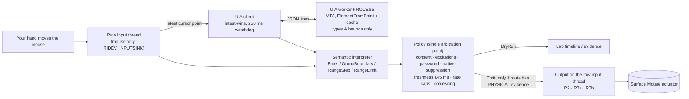

# Haptics Everywhere · Haptics Lab

**What if existing Windows apps gained useful tactile feedback overnight, without changing a line of their code?**

The Surface Mouse (2nd Edition) can buzz. Today it only does so where an app (or Windows itself — Snap,
PowerPoint alignment) explicitly calls the haptics API. This repo tests an *outside-in* idea: a small,
consent-first background process that **observes** your real mouse and the UI under it (via accessibility),
works out what you just did — *entered a toolbar button, crossed into a menu, dragged a slider past a detent* —
and kicks the mouse's haptic actuator to match.

It is built as an **evidence-first lab**, not a demo. The key platform question is genuinely unknown:

> Can a normal, non-elevated, non-injected Windows process make the mouse buzz **while another app is in the
> foreground**, using supported public APIs?

The documented `InputHapticsManager` routes feedback to *"the device that most recently delivered input to the
associated thread"*. Whether background Raw Input counts is exactly what nobody has measured. So this repo
ships the instruments to find out, refuses to call an API `true` a "buzz", and only promotes what a human
hand has actually felt.

> **We never move, click, or steer the mouse, and never control other apps.** The user drives the pointer; we
> only observe and add tactile feedback. See [`docs/PRIVACY_AND_THREAT_MODEL.md`](docs/PRIVACY_AND_THREAT_MODEL.md).

## Status

| Gate | What it means | State |
|---|---|---|
| **A1** Foreground actuation | Our own focused window can make the target mouse buzz (EXP-010) | ⏳ needs a human + Surface Mouse |
| **A2** Background actuation | It still buzzes with *another* app in front (EXP-020, routes R2/R3a/R3b) | ⏳ needs a human + Surface Mouse — **the go/no-go** |
| **B** Observation | Background raw input (EXP-030 ⏳) and UIA semantics (EXP-040 ✅ 23/23 fixture controls, p95 ≈ 6 ms) | partial |
| **C** Composition | Latency, duplicates, cost in real apps | blocked on A2 |
| **D** Value | Do people want it on? | blocked on C |

Everything that can be verified without a hand on a mouse **has been run** on a Surface Laptop 8 (Snapdragon,
Windows 26H1 build 28000, ARM64) — see [`docs/EVIDENCE_LEDGER.md`](docs/EVIDENCE_LEDGER.md). Notable real findings
so far:

- The 28000 SDK haptics API is present and `IsSupported()` / `IsHapticDevicePresent()` are `true` (the touchpad is haptic too).
- `InputHapticsManager` **enforces thread affinity**: `TryGetForThread` hands you another thread's manager, but any
  call on it fails with `RPC_E_WRONG_THREAD (0x8001010E)` (EXP-023).
- With only *posted* (non-device) input, the UI thread's manager has **no controller** and `TrySendHapticWaveform`
  returns `false` — routing really is tied to physical device input.
- The isolated UIA worker identified **23/23** controls in the WinForms fixture, p50 ≈ 4 ms, and the hang watchdog
  cuts off a frozen provider in ≈ 240 ms without blocking the caller (EXP-040, EXP-043).
- WinForms `TrackBar` exposes `Slider` with ValuePattern only (no RangeValue), so slider detents correctly stay
  silent there — the lab never reads value strings.

## Try it (5 minutes to first dashboard)

Requirements: Windows 11 (haptics API needs build 26100+ with Universal API Contract 19; tested on 28000),
.NET 10 SDK. x64 and ARM64 both work (AnyCPU).

```powershell
git clone https://github.com/shanselman/haptic-outside-labs
cd haptic-outside-labs
dotnet test                      # 63 tests: evidence rules, policy, golden traces, schemas, safety scans, UIA worker
.\scripts\run-lab.ps1            # opens the Haptics Lab dashboard
```

Then follow **[`docs/TESTING_WITH_SURFACE_MOUSE.md`](docs/TESTING_WITH_SURFACE_MOUSE.md)** — a ~20 minute
operator runbook: EXP-010 (foreground baseline) → EXP-020 (background gate) → optional live observer and tray.

CLI (all commands write `artifacts/runs/<run-id>/{result.json,trace.jsonl,summary.md}`):

```powershell
.\scripts\run-lab.ps1 doctor              # EXP-000 capability inventory (never sends a waveform)
.\scripts\run-lab.ps1 list-experiments
.\scripts\run-lab.ps1 run-all             # every automated experiment; never moves the pointer or buzzes
.\scripts\run-lab.ps1 run EXP-010         # physical: opens the blinded trial window
.\scripts\run-lab.ps1 replay tests\traces\toolbar-fast-flick.jsonl
.\scripts\run-lab.ps1 report              # artifacts\report.html
```

## How it works



- **Observation is passive.** Mouse-only Raw Input (no keyboard, no `NOLEGACY`/`CAPTUREMOUSE`), read-only UI
  Automation for control *type* and *bounds* (never names, text, values, URLs; slider range only). No hooks, no
  injection, no `SendInput`, no focus changes — enforced by a metadata scan of the compiled assemblies (EXP-081).
- **UIA runs in a separate process** on a windowless MTA thread. One outstanding request, latest-wins coalescing,
  hard timeout → kill & restart, per-app quarantine, no late delivery.
- **Semantics before sensations.** Hover only on *enabled interactive* controls, group-boundary `Step`s for
  ribbon/menu transitions, slider detents/limits only during a physical drag. Never `Success`/`Error` (we can't
  know an outcome). A wrong affirmative buzz is worse than a missed one.
- **One arbitration point.** Every intent passes the same policy: consent, app allow/deny lists, password/protected
  contexts, device availability, freshness deadline (stale = dropped, never late-buzzed), native-haptic
  suppression (Snap/PowerPoint drags), fast-flick suppression, re-entry cooldown, ≤4 pulses/s.
- **Output routes under test** (EXP-020), all called on the thread that just received the physical `WM_INPUT`:
  - **R2** `InputHapticsManager.GetForCurrentThread()` on the raw-input thread.
  - **R3a** a `SimpleHapticsController` captured from `CurrentHapticsController` during a moment when *our*
    window had mouse input, reused later.
  - **R3b** that controller installed via `SetOverrideHapticsController`, send, clear.

## The evidence model

| Class | Means | Proves a buzz? |
|---|---|---|
| `BUILD` | API discovered / guarded at runtime | No |
| `OBSERVED` | Instrumented event or call result (e.g. `SEND_RETURNED_TRUE`) | No |
| `PHYSICAL` | Blinded operator trials: pulses felt vs silent controls, one-sided Fisher p ≤ 0.01, hit ≥ 80%, false alarm ≤ 20% | **Yes, for that machine/route** |

`ExperimentResult.Finalize()` mechanically downgrades any `PASS` on a physical claim without `PHYSICAL` evidence,
and the tray's **On** switch reads the local ledger: it stays locked until a background route has a `PHYSICAL`
`PASS` on *this* machine fingerprint. Statuses are `PASS / FAIL / INDETERMINATE / BLOCKED / NOT_RUN /
SKIPPED_BY_POLICY` — a "not felt" is only a `FAIL` if the foreground baseline already passed.

## Repository map

```text
src/Haptics.Core        platform-neutral: evidence contracts, blinded-trial stats, semantics, policy, replay, ledger, API scanner
src/Haptics.Windows     Win32/WinRT adapters: raw-input message thread, guarded haptics routes, UIA worker+client, pipeline
src/Haptics.Lab         haptics-lab.exe: CLI, dashboard, experiments EXP-000/010/020/023/030/040/043/070/081, UI fixture
src/Haptics.Tray        haptics-tray.exe: Off / Observe-only / On (evidence-gated), consent, per-app lists, kill switch
tests/                  Core tests (evidence, policy, 13 golden traces) + Windows tests (safety scans, worker containment)
docs/                   SPEC, runbook, evidence ledger, hypotheses, research notes, design notes, privacy/threat model, ADRs
schemas/                JSON schemas for results and traces
fixtures/browser        static HTML/ARIA page for manual Chromium/Edge checks (EXP-050)
```

## Docs

- [`docs/TESTING_WITH_SURFACE_MOUSE.md`](docs/TESTING_WITH_SURFACE_MOUSE.md) — operator runbook (start here with hardware)
- [`docs/EVIDENCE_LEDGER.md`](docs/EVIDENCE_LEDGER.md) — what has actually been measured, where, and with which commit
- [`docs/HYPOTHESES.yaml`](docs/HYPOTHESES.yaml) — H1–H8 with falsifiers and current state
- [`docs/DESIGN_NOTES.md`](docs/DESIGN_NOTES.md) — the thinking: decisions, trade-offs, what was deliberately not built
- [`docs/RESEARCH.md`](docs/RESEARCH.md) — verified API surface, SDK/TFM pitfalls, observed platform behaviour
- [`docs/TEST_MATRIX.md`](docs/TEST_MATRIX.md) — what each test layer can and cannot prove
- [`docs/PRIVACY_AND_THREAT_MODEL.md`](docs/PRIVACY_AND_THREAT_MODEL.md) — data minimization, hard constraints, harms
- [`docs/ADR/`](docs/ADR) — architecture decision records
- [`docs/SPEC.md`](docs/SPEC.md) — the full engineering specification this implements

## What's next

1. **Run EXP-010 and EXP-020 with a Surface Mouse** (the runbook). This single result decides the architecture.
2. If a background route passes: EXP-030 (raw attribution), live toolbar/ribbon hover in Word/Edge/Explorer
   (EXP-070 physical), native double-buzz A/B (EXP-075), latency/CPU (EXP-080), then a small dogfood of the tray.
3. If none passes: the semantic layer (Gate B) still stands; the output path pivots to a supported first-party or
   vendor route (SPEC §15). The tray will not pretend otherwise.
