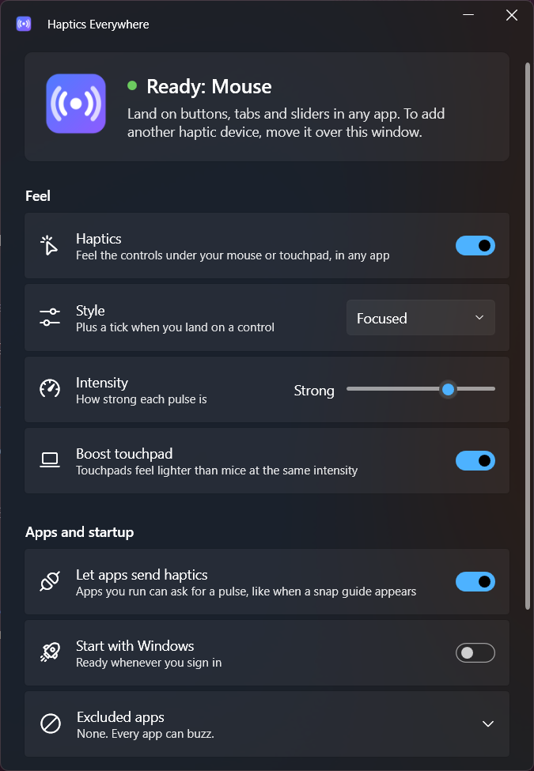
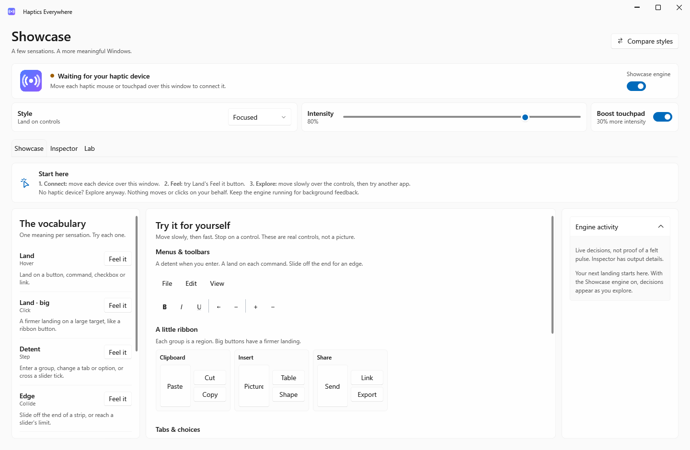
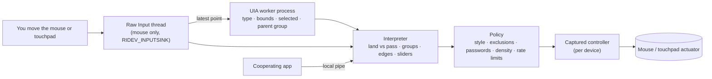

# Haptics Everywhere

**Feel the things you can *do* in Windows: buttons, tabs, ribbons, menus and sliders. In any app, with no
changes to those apps.**

<p align="center">
  
</p>

The Surface Mouse (2nd Edition) and Surface haptic touchpads can buzz, but only where an app explicitly asks.
Haptics Everywhere is a small background app that *observes* your pointer and the UI under it (through Windows
accessibility) and adds a light, meaningful tick when you land on something actionable. A detent tells you that you
changed a toggle or crossed a slider tick; an edge tells you that you reached a slider endpoint.

> **It never moves, clicks, or focuses anything, never reads the keyboard, and never reads names or text.** It's passive:
> mouse input plus read-only UI structure. Nothing leaves your PC. See [`docs/PRIVACY_AND_THREAT_MODEL.md`](docs/PRIVACY_AND_THREAT_MODEL.md).

## Get it

**What's new:** 0.8.1 makes the Showcase tables easier to read in light and dark themes. 0.8 made the Quiet and
Focused styles more consistent and added taskbar buttons to Everything. Earlier releases added experimental pen
support (off by default) and a **Visual demo** that shows where a haptic would play. This is still a
proof-of-concept tester build; the [validation checklist](docs/AUTOMATIC_PRIMING_TEST_PLAN.md) tracks what has
and hasn't been checked.

Download `HapticsEverywhere-<version>-win-arm64.zip` (Snapdragon Surfaces) or `-win-x64.zip` from
[**Releases**](https://github.com/shanselman/haptic-outside-labs/releases). It's self-contained, so no .NET install is
needed. Unzip it, then:

| Run | What it is |
|---|---|
| `haptics-tray.exe` | **The app.** It starts on and tries to find your haptic device by itself. If it can't, Settings opens: move your mouse or touchpad over it once. Click the tray icon for settings; right-click it for a quick menu. |
| `haptics-lab.exe` | **The Showcase.** Feel each sensation, try it on real controls, see why a tick did or didn't happen, and compare styles. |

Some releases also include an **experimental `.msixbundle` installer** that adds Start menu entries and a normal
uninstall. Read the [MSIX notes](docs/RELEASING.md#optional-msix-bundle) first; the ZIPs remain the portable option.

**Trying the Showcase:** follow **Start here**. Move your haptic device over the window, click **Feel it** next
to Land, then try the sample controls or another app. If the tray is already running, the Showcase pauses its own
engine so you don't get double feedback.

**No haptic hardware?** Turn on **Visual demo** (top right). It shows a ripple at the pointer wherever a haptic
would play, in any app, without sending any haptics. The tray's **Show ripples** option does the same alongside
real haptics, which is handy for screen recordings. Ripples show intent, not proof that anything was felt.

<p align="center">
  
</p>

Requirements: Windows 11 with the haptics API (build 26100+, Universal API Contract 19; built and tested on 28000) and a
haptic mouse or touchpad.

### Experimental single-pen support

Pen support is off by default. To try it, turn on **Experimental single pen** in the tray's Settings, then hover
your haptic pen over Settings once. When it's ready, **Ready** shows `Pen`.

- Use **one pen** only. Windows tells us "a pen" moved, not which pen.
- To switch pens, turn the option off and on again, then hover the new pen.
- If the pen goes quiet (for example after removing a device or turning Haptics off), hover it over Settings again.
- So far, pen ticks have been felt in the tray's own Settings window (with some skipped), but **not yet in other
  apps**. Don't rely on it yet.

The details, test commands and evidence are in
[`docs/RESEARCH.md`](docs/RESEARCH.md#experimental-single-pen-support-details).
For continuous drawing textures rather than UI ticks, see the related
[Slim Pen Tool](https://github.com/stephenlwaldron/windows-slim-pen-2-tool).

## What you feel

Three automatic sensations, plus an explicit Click preview:

| Sensation | Waveform | Means | Examples |
|---|---|---|---|
| **Land** | Hover | You landed on something you can do | tabs, buttons, menu commands, links, combo boxes, slider thumbs; Everything also adds radio options and group entry |
| **Click preview** | Click | Explicit waveform preview, not automatic landing feedback | Showcase's Click preview; all automatic button landings use Hover |
| **Detent** | Step | A state tick | click-confirmed checkbox/toggle changes; slider ticks while dragging |
| **Edge** | Collide | A slider endpoint | a dragged slider reaching its minimum or maximum; strip exits stay silent |

**Choosy on purpose:**
- **Landing, not passing.** You have to rest on a control for a moment (30–50 ms). Flying past is silent.
- **Silent on purpose:** windows, text, list and grid rows, the tab you're already on, disabled controls, tiny
  targets, password fields, password managers and sign-in screens.
- **No faked outcomes.** We can't tell whether a save or drop worked, so Success, Error and Align come only from
  apps that tell us (see *Cooperating apps*).

**Styles:**
| Event | Quiet | Focused | Everything |
|---|---|---|---|
| Unselected tabs and inline text links | Hover | Hover | Hover |
| Text-sized links inside Groups | - | Hover | Hover |
| Dropdown pickers and explicit menu/SplitButton roles | - | Hover | Hover |
| Slider thumb hover | - | Hover | Hover |
| Slider drag detents/endpoints | Step/Collide | Step/Collide | Step/Collide |
| Click-confirmed checkbox/toggle changes | - | Step | Step |
| Other links, picker options, ordinary Buttons, toggle/radio hover, open menu choices, group entry | - | - | Hover |
| Primary/secondary taskbar buttons | - | - | Hover |

**Quiet** is the gentlest, **Focused** adds menus, pickers and sliders, and **Everything** adds most buttons and
links. Each style includes everything in the one before it. Rate limits keep it from buzzing too often in every
style. The exact rules are in
[`docs/RESEARCH.md`](docs/RESEARCH.md#how-each-style-decides-detailed-rules).

Intensity runs Low → Max. Touchpads get a boost, because they feel lighter than mice at the same strength.

## How it works (automatic startup, with priming as a fallback)



Windows normally only lets an app buzz a device while that app's own window is getting input from it. A
background app never gets that input, and our blinded tests confirmed it never got a controller (0 of 288 tries).

**What works:** grab the device's haptic controller once while you move it over our window (we call this
"priming"), then keep using it from the background. That was felt 6 of 6 times vs 0 of 6 silent controls.

The tray also tries an **experimental, undocumented** Windows lookup at startup so you usually don't have to prime
at all. If that fails or takes more than two seconds, the priming window appears instead. It also looks again when
a device reconnects. Touchpads and new devices may still need priming. Details are in
[`docs/RESEARCH.md`](docs/RESEARCH.md#experimental-acquisition-without-window-input-2026-10-27), and
[`samples/MinimalBackgroundHaptics`](samples/MinimalBackgroundHaptics/Program.cs) shows the whole trick in
about 150 lines.

## Cooperating apps

Apps know things we can't infer, like "a snap guide appeared" or "the drop was accepted". Any app running as the same
user can send a haptic over the local pipe `HapticsEverywhere`. It still goes through the same policy (rate limits,
exclusions):

```powershell
$p = [System.IO.Pipes.NamedPipeClientStream]::new('.', 'HapticsEverywhere', 'Out'); $p.Connect(500)
$w = [System.IO.StreamWriter]::new($p); $w.WriteLine('{"waveform":"Align"}'); $w.Flush(); $p.Dispose()
```

Or run `haptics-lab coop-send Success`. Valid waveforms: Hover, Click, Step, Collide, Align, Success, Error, Grow,
Press, Release (whatever your device supports).

## Build from source

```powershell
git clone https://github.com/shanselman/haptic-outside-labs
cd haptic-outside-labs
dotnet test                      # vocabulary rules, golden traces, policy, safety scans, UIA worker, tray, Showcase
.\scripts\run-tray.ps1           # the app
.\scripts\run-lab.ps1            # the Showcase
.\scripts\publish.ps1            # self-contained zips for win-arm64 and win-x64
```

.NET 10 SDK, Windows only. Projects target `net10.0-windows10.0.26100.0` with the 28000 SDK projection (ADR 0005).

## The research behind it

This started as an evidence-first lab: the platform question ("can a normal background app buzz the mouse while
another app is in front?") was genuinely unknown, so the repo was built to *prove* it rather than assume it. It
used blinded pulse/no-pulse trials, Fisher exact tests, and an evidence ledger that never counts an API returning `true`
as a buzz. The answer is **yes, via a captured controller**:

| Gate | Result (Surface Laptop 8, Windows 28000, ARM64, Surface Mouse 2nd Edition) |
|---|---|
| Foreground actuation (EXP-010) | **PHYSICAL PASS**: 12/12 felt vs 0/6 silent controls |
| Background actuation (EXP-020) | **PHYSICAL PASS** via captured controller (R3a, R3b: 6/6 vs 0/6 each); plain background route R2 **FAIL** |
| UIA semantics (EXP-040/043) | 23/23 fixture controls, p95 ≈ 4–6 ms; hung providers cut off in ≈ 240 ms |

The lab is still there (the Showcase's **Lab** tab, `haptics-lab run …`) for checking new devices and builds, but you
don't need it to use the app. Start with [`docs/EVIDENCE_LEDGER.md`](docs/EVIDENCE_LEDGER.md),
[`docs/DESIGN_NOTES.md`](docs/DESIGN_NOTES.md) and the operator runbook
[`docs/TESTING_WITH_SURFACE_MOUSE.md`](docs/TESTING_WITH_SURFACE_MOUSE.md).

## Repository map

```text
src/Haptics.Core        vocabulary rules (interpreter + policy), evidence model, golden-trace replay, API scanner
src/Haptics.Windows     raw input, guarded haptics routes, per-device controller bank, UIA worker, cooperative pipe
src/Haptics.Tray        haptics-tray.exe — the app (tray icon + WPF-UI settings window)
src/Haptics.Lab         haptics-lab.exe — WPF-UI Showcase + embedded Inspector/Lab, CLI, WinForms experiments/fixtures
samples/                MinimalBackgroundHaptics — the core trick in ~150 lines
assets/                 app icon (regenerate with scripts/make-icon.ps1), README screenshot
tests/                  Core tests (vocabulary, policy, 13 golden traces) + Windows tests (safety scans, worker, tray)
docs/                   design notes, evidence ledger, hypotheses, research, privacy/threat model, ADRs, SPEC
```

## Docs

- [`docs/DESIGN_NOTES.md`](docs/DESIGN_NOTES.md): decisions, trade-offs, the haptic vocabulary
- [`docs/EVIDENCE_LEDGER.md`](docs/EVIDENCE_LEDGER.md): what has been measured, where, and with which commit
- [`docs/PRIVACY_AND_THREAT_MODEL.md`](docs/PRIVACY_AND_THREAT_MODEL.md): what's observed, hard constraints, harms
- [`docs/RESEARCH.md`](docs/RESEARCH.md): API findings, platform behaviour, pen details and the exact style rules
- [`docs/TEST_MATRIX.md`](docs/TEST_MATRIX.md): what each test layer can and cannot prove
- [`docs/AUTOMATIC_PRIMING_TEST_PLAN.md`](docs/AUTOMATIC_PRIMING_TEST_PLAN.md): no-wiggle validation checklist and recovery TODOs
- [`docs/TESTING_WITH_SURFACE_MOUSE.md`](docs/TESTING_WITH_SURFACE_MOUSE.md): operator runbook for the physical experiments
- [`docs/RELEASING.md`](docs/RELEASING.md): signing secrets and cutting a signed release
- [`docs/ADR/`](docs/ADR), [`docs/HYPOTHESES.yaml`](docs/HYPOTHESES.yaml), [`docs/SPEC.md`](docs/SPEC.md)

## What's next

1. **Controller lifetime (EXP-082):** does a captured controller survive idle, sleep/resume, and Bluetooth re-pair?
2. **Blind style comparison (EXP-090):** Showcase → *Compare styles*. Which style do people keep on?
3. **Native double-buzz A/B (EXP-075)** against Snap and PowerPoint; **latency/CPU in real apps (EXP-080)**.
4. Per-app profiles tuned by feel; more cooperating apps.
