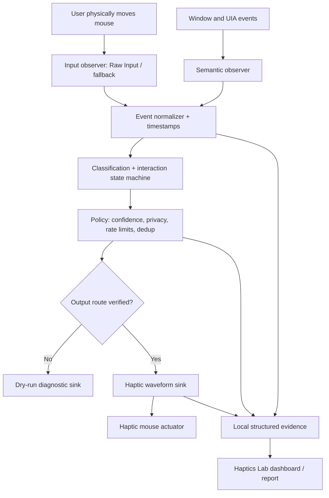
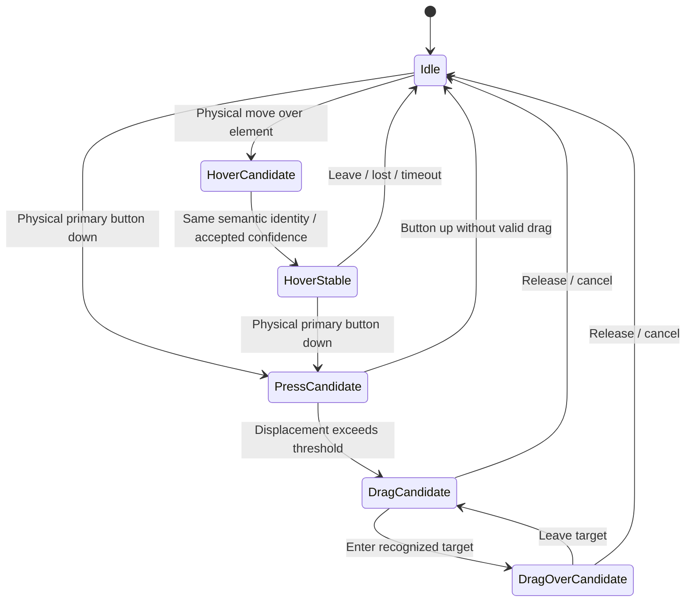
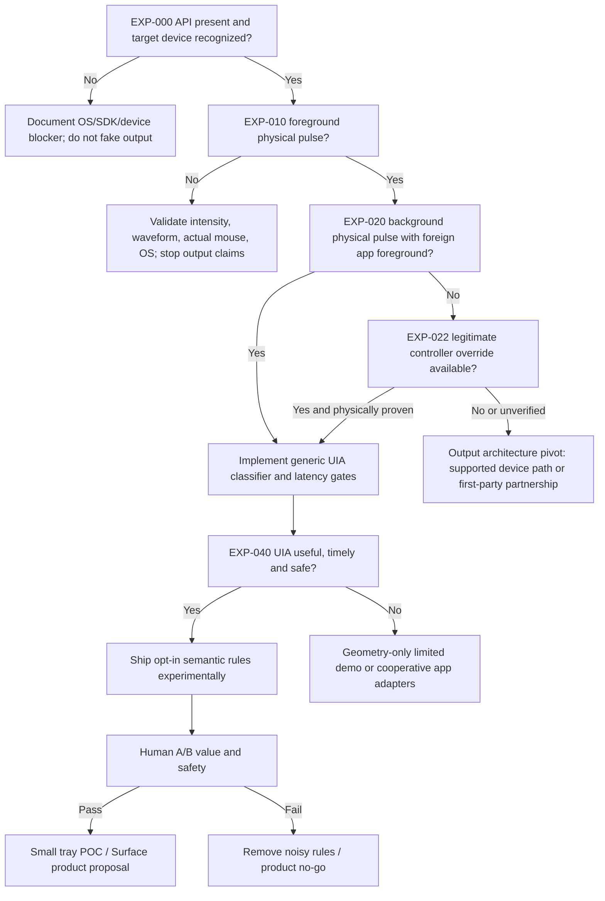

# Haptics Everywhere: An Evidence-Driven Windows Haptics Lab

**Document type:** Copilot engineering handoff, research specification, and experimental acceptance contract  
**Version:** 1.0 / 2026-10-22  
**Status:** Ready for implementation; platform feasibility NOT YET established  
**Working project name:** Haptics Everywhere / Haptics Lab  
**Initial target:** Windows desktop with a haptic-capable Surface Mouse (2nd Edition); extensibility to other supported haptic mice/touchpads is desirable but not assumed.  
**Authoritative constraint:** The user physically moves and operates the mouse. This software NEVER moves the pointer or controls other applications during normal operation. It *observes* interaction and adds tactile feedback. Test automation may synthesize pointer events **only inside explicitly opted-in test environments**.

---

## Navigation

- [0. Instruction to GitHub Copilot: read this before writing code](#0-instruction-to-github-copilot-read-this-before-writing-code)
- [1. Original request and precise product intent](#1-original-request-and-precise-product-intent)
- [2. Evidence policy and research baseline](#2-evidence-policy-and-research-baseline)
- [3. Recommended architecture: one lab solution, isolated hypotheses](#3-recommended-architecture-one-lab-solution-isolated-hypotheses)
- [4. Platform research: input and output are separate problems](#4-platform-research-input-and-output-are-separate-problems)
- [5. Semantic interaction model: “what did the mouse mean?”](#5-semantic-interaction-model-what-did-the-mouse-mean)
- [6. Experiment plan: prove the fundamentals before stacking features](#6-experiment-plan-prove-the-fundamentals-before-stacking-features)
- [7. Interaction catalog and deployment priority](#7-interaction-catalog-and-deployment-priority)
- [8. Haptic language, arbitration, and anti-noise policy](#8-haptic-language-arbitration-and-anti-noise-policy)
- [9. Precise threading, latency, and failure design](#9-precise-threading-latency-and-failure-design)
- [10. Privacy, security, consent, and second-order effects](#10-privacy-security-consent-and-second-order-effects)
- [11. Repository organization and build system](#11-repository-organization-and-build-system)
- [12. Automated testing strategy and a deterministic evidence pipeline](#12-automated-testing-strategy-and-a-deterministic-evidence-pipeline)
- [13. Evidence ledger: make discoveries accumulate instead of evaporate](#13-evidence-ledger-make-discoveries-accumulate-instead-of-evaporate)
- [14. Exact proposed Copilot implementation sequence](#14-exact-proposed-copilot-implementation-sequence)
- [15. Stop/go decision tree (explicit pivots)](#15-stopgo-decision-tree-explicit-pivots)
- [16. Acceptance criteria / definition of done](#16-acceptance-criteria-definition-of-done)
- [17. Open design questions Copilot should record, not block on](#17-open-design-questions-copilot-should-record-not-block-on)
- [18. Instructions for the first Copilot coding session (copy/paste)](#18-instructions-for-the-first-copilot-coding-session-copypaste)
- [19. Summary for an engineering sponsor](#19-summary-for-an-engineering-sponsor)
- [20. Primary-source references and verification ledger](#20-primary-source-references-and-verification-ledger)

---

## 0. Instruction to GitHub Copilot: read this before writing code

You are implementing a **scientific engineering workbench** that may evolve into a lightweight background Windows tray application. Do not begin by implementing a large, always-on global haptics utility and declaring success. The core integration assumption is uncertain. Build the evidence-producing probes first, make unknowns visible, and promote only proven components into the reusable pipeline.

**Deliver two things in one Git repository:**

1. **Haptics Lab:** a single discoverable desktop dashboard and command-line test runner that launches **isolated, small experiment processes**, collects machine-readable evidence, runs repeatable unit/integration tests, and maintains a durable hypothesis ledger. The lab must include controlled UI fixtures and diagnostics.
2. **Haptics Everywhere Tray (prototype):** a separate tiny executable using the lab's **verified** observation, interpretation, policy, and haptic-output components. It must start in **observe-only / silent** mode and stay disabled if no verified output route exists.

**Avoid both bad extremes:**

- Not a collection of one-off, throwaway sample projects with screenshots and no cumulative knowledge.
- Not one giant monolithic EXE where hardware failure, broken COM calls, test automation, and a tray UI all share one fault domain.

This is **one solution, one repository, one test vocabulary, one evidence ledger; multiple modules and process-isolated experiments**. The lab presents a coherent user experience; the isolation is an engineering implementation detail.

**Do not generate claims of success from code compiling, `IsSupported()`, `TrySendHapticWaveform` returning `true`, or a mocked waveform sink.** Those prove different things. Each experiment must explicitly label which layer it has actually demonstrated.

**First implementation objective:** within the Haptics Lab, prove or disprove a meaningful version of this statement:

> While another application is foreground, a normal, non-elevated, non-injected Windows process can observe actual physical mouse movement and cause an independently discernible haptic effect on the mouse with acceptable timing, using supported APIs.

If that statement is false, produce the diagnostic evidence and explore bounded alternatives. Do not hide the failure behind an imitation animation, sound, or a mock effect.

### Required behavior of the coding agent

- Work in small compileable commits/PRs with tests and an updated `docs/EVIDENCE_LEDGER.md`.
- Treat `[DOC]`, `[HYPOTHESIS]`, `[OBSERVED]`, `[INFERRED]`, and `[DECISION]` as different states; never silently turn one into another.
- Prefer documented, non-injected, standard-user API routes. Use elevated capabilities, UIAccess, protocol-specific HID access, injection, or app-specific debugging connections only as **explicitly proposed, independently reviewed research branches**—never automatic fallback.
- Make every platform feature runtime-detectable, with a graceful `Unsupported`, `Blocked`, `Unavailable`, or `Indeterminate` result.
- Preserve the original idea: **semantic tactile augmentation for arbitrary existing applications**. Do not turn this into a mouse macro recorder, pointer driver, remote-control application, screen scraper, or application automation tool.
- All production observation must be **passive**: no control-pattern `Invoke`, no `SetFocus`, no DOM mutations, no `SendInput`, no cursor warping, no mouse capture, no third-party DLL injection.
- For each probe, implement a negative control and a clear falsification condition wherever practical.
- Use the primary-source links in the references; recheck signatures and installed SDK metadata instead of trusting a generated snippet.

---

## 1. Original request and precise product intent

### 1.1 Origin

The Surface Mouse (2nd Edition) supports advanced haptics and existing Microsoft-described experiences, such as Windows Snap and PowerPoint object alignment, with additional named creative applications. The user wants to generalize that experience to software whose developers **did not** call Microsoft's haptics API. Microsoft documents the device, its existing experiences, and adjustable haptic intensity. [S01]

The conventional adoption motion asks individual application developers—Adobe, Microsoft 365, Teams, Slack, and others—to instrument their own apps. This project tests an **outside-in** approach: can a resident Windows application observe the current pointer and the UI underneath it and infer enough semantic meaning to emit tasteful haptics without cooperation from the app being used?

The original examples were:

- Moving across ribbon or toolbar buttons in Word, Paint.NET, Slack, or Teams.
- Moving onto minimize, maximize, close, Start menu, or taskbar controls.
- Entering or leaving discrete controls, tabs, list items, or menu boundaries.
- Grabbing, dragging, entering a target, dropping, and receiving a short tactile signal.
- Moving or scrolling through quantized states, e.g., slider detents, tab boundaries, logical scroll stops.
- Possibly creating a sense of *texture* or *edges* in UI regions, if useful and technically justified.

The user also explicitly asked for:

- Deep research into Win32, UI Automation, browser/Electron/WebView2, and more difficult graphics/custom-control surfaces.
- A good/better/best ladder based on introspection capability.
- Low overhead, low latency, and broad coverage, ideally a tiny tray process.
- Serious consideration of DLL injection and other deeper approaches **as researched alternatives**, not a default.
- An `.md` engineering handoff that Copilot can implement, commit, build, run, and iterate against test evidence.
- A framework that makes ambiguous Windows/hardware behavior **empirically knowable**.

### 1.2 Critical correction from the user

**We are NOT driving, steering, accelerating, or moving the mouse from an external process.** The user's own mouse behavior is observed. The application then **kicks the haptic actuator** according to what that interaction means.

The phrase “drive the mouse” is misleading and should not appear in architecture or code except as an explicitly prohibited behavior. We are **driving haptic output**, not pointer motion.

### 1.3 Product thesis

> What if existing Windows applications gained useful tactile affordances overnight, without changing a line of their code?

This is an **augmentation layer**, potentially upstream of future Surface app integration—not a new required interface for third-party developers.

### 1.4 Principles

1. **Signal over noise.** A meaningful boundary or outcome is valuable; vibration for every pixel or generic hover is not.
2. **Semantic truthfulness.** Never buzz `Success` when only a mouse-button release was observed; a drop may have been rejected. Prefer weaker “interaction occurred” signals or silence when the outcome is unknown.
3. **No behavioral changes.** Pointer trajectories, clicks, keyboard input, focus, app state, and OS window manipulation are untouched in production.
4. **Respect native feedback.** Do not duplicate Windows/Surface/app-provided haptics, especially Snap and aligned objects where already supported.
5. **Low-cost by default.** Subscribe to input and target-local semantic events; do not traverse every process's entire accessibility tree on every mouse event.
6. **Fail silently and safely.** Unknown semantics, slow providers, protected UIs, and unsupported devices should produce **no haptic** rather than misleading or delayed feedback.
7. **Visible epistemics.** Documented platform support is not measured machine-specific behavior; measured behavior on a single configuration is not universal support.
8. **Consent first.** The ability to observe the desktop is a privacy-sensitive power. Explicit enablement, narrow scope, and local-only diagnostics are architectural requirements.

### 1.5 Non-goals (v1)

- Replacing Windows input routing, writing a mouse driver, or generating pointer movement.
- Providing a globally accurate drag/drop oracle for every app.
- Reading the content of documents, messages, URLs, passwords, or text boxes to choose haptics.
- Bypassing UAC, protected desktops, anti-cheat, sandboxing, permissions, or app security controls.
- Building a universal AI screen-understanding agent or collecting continuous screenshots.
- Auto-enabling accessibility settings in other programs or modifying their command lines.
- Shipping a polished commercial Surface feature before feasibility and usability tests.
- Claiming tactile sensations that have not been physically verified on target hardware.

---

## 2. Evidence policy and research baseline

This document distinguishes four materially different layers:

| Label | Meaning | Example | Counts as proof of usable haptics? |
|---|---|---|---|
| `[DOC]` | Confirmed by an identified primary-source specification | `RIDEV_INPUTSINK` accepts background raw input | No |
| `[BUILD]` | Verified build and API activation on a machine | `InputHapticsManager` resolves at runtime | No |
| `[OBSERVED]` | Instrumented runtime event or call result | `WM_INPUT`, UIA hit, waveform API returned true | Only for that subclaim |
| `[PHYSICAL]` | Mouse vibration independently confirmed by a human or sensor | Tester perceives a discrete pulse while Word has focus | Yes, for that hardware/test |

Additional statuses: `[HYPOTHESIS]`, `[INFERRED]`, `[UNVERIFIED]`, `[BLOCKED]`, `[FAIL]`, `[INDETERMINATE]`, and `[NOT_RUN]`.

A result record must never collapse these categories into a single green checkmark. If a haptics API returns true but nobody or nothing verifies actuator movement, record **`OUTPUT_API_ACCEPTED / PHYSICAL_UNCONFIRMED`**, not `PASS`.

### 2.1 Facts established by official documentation

- [DOC] The Surface Mouse (2nd Edition) has advanced haptics; Microsoft documents Snap, PowerPoint alignment, and named third-party application experiences. [S01]
- [DOC] `Windows.Devices.Haptics.InputHapticsManager` is the relevant modern app-facing haptic API; Microsoft illustrates runtime feature checks and waveform submission. [S02] [S03]
- [DOC] The haptics documentation states SDK `10.0.28000.1721` / Universal API Contract v19 as a requirement, with `Align`, `Collide`, `Step`, `Grow` added with `10.0.28000.1839`. **SDK availability, contract metadata, and actual running OS support must be tested separately**; the class reference also displays older build applicability and prerelease cautions, so do not infer universal deployment simply from an SDK version number. [S02] [S03] [S04]
- [DOC] The manager is associated with the thread receiving recent input, and its object must be used on its owning thread. The normal sample calls `GetForCurrentThread()` from the foreground/input-owning thread. [S02] [S03]
- [DOC] `SetOverrideHapticsController` can accept a known `SimpleHapticsController` and device type; its documented uses include background-thread marshaling **when the controller was obtained on an input thread**. It does **not** document arbitrary acquisition of another app's mouse controller. [S05]
- [DOC] `TryGetForThread` retrieves an existing manager for a thread if one exists. Its reference does **not** guarantee cross-process rights or safe invocation from another process's thread. [S06]
- [DOC] Raw Input with `RIDEV_INPUTSINK` and `WM_INPUT` can deliver physical mouse input to a background window even while another app is foreground. This is an observation fact, **not proof that such input makes the haptics manager route to that mouse**. [S07] [S08]
- [DOC] `SetWinEventHook(..., WINEVENT_OUTOFCONTEXT)` receives selected accessibility/window events without mapping a callback DLL into the emitting application. Events are asynchronous and require a message loop. [S09]
- [DOC] UI Automation can get an element from a screen point; cached requests avoid repeated cross-process property calls. Cross-desktop UI Automation clients should use a separate COM MTA thread for UIA operations. Providers may omit some events. [S10] [S11] [S12] [S13]
- [DOC] Native UI Automation support became enabled by default in Chromium-based Windows browsers beginning with Chrome 138; Electron and WebView2 accessibility exposure depend on their own implementation and runtime configuration. [S14] [S15] [S16]
- [DOC] Microsoft publishes haptic waveform semantics and recommends roughly sub-50-ms cause-to-feedback latency. [S17] [S18]

### 2.2 Primary unresolved questions—not platform facts

| Hypothesis | Why it matters | What would falsify it? |
|---|---|---|
| **H1.** Background `WM_INPUT` gives this process a haptic-routeable device context | Without it, the central no-injection design might fail | Real input observed while another app is foreground, yet no device controller is present or no physically confirmed pulse despite a positive foreground baseline |
| **H2.** A haptic controller obtained in this process can remain usable for short background actions | Candidate workaround if H1 fails | Obtained controller disappears, override expires, calls fail, or physical actuation is absent with another app foreground |
| **H3.** Accessibility hit testing can identify UI regions on useful timescales | Enables generic toolbar/ribbon semantics | Hit tests routinely time out, return only a container, or trigger after the cursor has left |
| **H4.** UIA semantic coverage is sufficiently broad across third-party apps | Enables outside-in adoption | Most selected target apps expose opaque/non-actionable regions or require special integrations |
| **H5.** Feedback can be timely and unobtrusive | Determines whether this is a feature or a nuisance | Measured delay, excessive vibration density, duplicate effects, CPU/battery cost, or user rejection |
| **H6.** Automation can verify most behavior deterministically | Enables fast Copilot iteration | Physical routing depends on hardware/input provenance and can only be established manually or with an external sensor |
| **H7.** Built-in effects can be avoided without privileged instrumentation | Avoids double buzz | Duplicate effects cannot be distinguished or conservatively suppressed |
| **H8.** Cross-app haptics offers genuine utility over app-specific instrumentation | Product justification | Users prefer only native haptics or disable the global layer under real usage |

**Critical distinction:** Even if H1 fails, H3/H4 are valuable research results. But **no production tray haptics** should be claimed until *some* supported, consent-respecting background output route passes physical confirmation.

---

## 3. Recommended architecture: one lab solution, isolated hypotheses

### 3.1 System topology



`Input observer` never manipulates user input. `Semantic observer` never invokes a control. `Output sink` only sends a haptic request when all gating conditions pass.

### 3.2 Two operational products

**Haptics Lab (research/debug product):** may have a full window, an inspector, tabs, fixture launching, charts, an experiment checklist, trace timelines, runtime capability probes, and manually signed-off physical tests. It exists to turn assumptions into reproducible observations.

**Haptics Everywhere Tray (eventual product):** tiny UI, `Off / Observe-only / On`, device indicator, currently active profile, exclusions, sensitivity/intensity settings, and one-click kill switch. No automated test fixture, no screenshot storage, no discovery by brute-force accessibility traversal. The tray process imports only production-qualified modules from the lab.

### 3.3 Process separation

- **Dashboard process:** presents results, controls opted-in experiments, and never blocks on foreign UIA calls.
- **Experiment runner process:** one short-lived runner per risky hypothesis; emits structured stdout or local IPC; watchdog kills a hung probe without killing the dashboard.
- **Fixture processes:** independently owned minimal Win32, WPF/WinForms, WebView2, and custom-drawn windows whose semantic truth can be instrumented.
- **Optional haptics output probe:** independent process using the documented Windows API; can run without any UIA integration.
- **Tray process:** small, persistent; not the test controller.

Use a small set of reusable class libraries for event models, policy, UIA adapters, haptic adapters, configuration, and evidence storage. Do not build a complicated distributed service architecture merely because multiple processes exist.

### 3.4 Shared contracts (logical, not mandatory source syntax)

Implement equivalent strongly typed models for:

- `PointerObservation`: monotonic timestamp, originating input type (`hardware_raw`, `synthetic`, `unknown`), device identity *ephemeral*, x/y screen pixels, button state, wheel data, foreground HWND/PID, session/desktop state, coordinate epoch.
- `ElementSnapshot`: source (`uia`, `winevent`, `geometry`, `fixture`, `adapter`), HWND/PID, ephemeral element identity, control type, bounding rectangle, `IsEnabled`, `IsOffscreen`, `IsPassword`, supported *read-only* pattern metadata, confidence, observation timestamp, privacy flags. No document/text values.
- `SemanticEvent`: `ENTER_CONTROL`, `LEAVE_CONTROL`, `CROSS_GROUP_BOUNDARY`, `START_DRAG_CANDIDATE`, `ENTER_DROP_CANDIDATE`, `RELEASE_DRAG_CANDIDATE`, `RANGE_STEP`, `WINDOW_EDGE`, `SCROLL_SEGMENT`, `NATIVE_SUPPRESS`, etc.; with confidence and evidence trail.
- `HapticIntent`: intent category (`Hover`, `Step`, `Collide`, `Align`, `Click`, `Grow`, ...), target device type, intensity, max duration/count, confidence, expiration deadline, source rule id, user setting version.
- `HapticAttempt`: intent id, output backend, API and device capability state, waveform requested and fallback, call return / HRESULT / exception, enqueue-to-call latency, and **distinct** physical validation status.
- `ExperimentResult`: immutable identifiers, hypothesis revision, machine fingerprint *redacted and consented*, OS/SDK/runtime/architecture, test mode, fixtures and versions, assertions, negative controls, trace artifact digests, status and explanation.

**No API contract should imply that UI Automation provides a universal drag/drop validity signal.** A pointer-up after a drag candidate is not proof of a successful drop.

### 3.5 Architectural invariants

- All high-volume input callbacks must return promptly: no synchronous UIA calls, disk writes, sleeps, haptic I/O, or process enumeration in a raw input or hook callback.
- UIA and WinEvent subscriptions use their required, isolated message-loop/COM threading semantics.
- Output calls run on the thread required by the selected output API, not arbitrarily on a worker from the .NET thread pool.
- An inaccessible or unresponsive provider cannot stall input observation or the dashboard.
- Each semantic intent has a deadline; stale intent is discarded instead of late-buzzed.
- Feedback always passes through the **single global arbitration/rate-limit policy**, including app-specific adapters.
- Every mode is explicitly user-visible. No recording by default, no background upload or external telemetry.

---

## 4. Platform research: input and output are separate problems

### 4.1 Haptic output: the hard gate

Microsoft's `InputHapticsManager` documentation defines a per-thread context: it targets the haptic device from which the thread recently received input, when supported. The reference says instances must be used on their owning thread; the implementation guide explicitly shows a UI/input-thread call. [S02] [S03]

This is **not** a documented system-wide “send a pulse to mouse with hardware id X from any arbitrary process” API. Whether a process that receives `WM_INPUT` through `RIDEV_INPUTSINK` qualifies as having received *input* for the haptics manager is **[UNVERIFIED]**. It is the first experiment, not an assumed fact.

Investigate these routes in the following order:

**R1 — Same-process foreground baseline (documented pattern).**

- Create a real, visible, focused test window. Receive physical mouse input in that window; obtain manager on the input-receiving thread; query capabilities; invoke a supported short waveform.
- Run a human-in-the-loop or external-sensor tactile check.
- This proves basic device/API/OS functionality, but **does not prove background use**.

**R2 — Same-process background Raw Input (main product hypothesis).**

- Register to receive mouse raw input with `RIDEV_INPUTSINK` into a window associated with a deliberately chosen, stable message-loop thread.
- Move the **physical** Surface Mouse while a different, unrelated application has focus.
- From the Raw Input receiving thread, test the manager and available controller immediately; request a short waveform and log separate response and tactile outcome.
- Test zero-delay, short-delay, varied event types, and loss of haptic context after idle.
- The point is to test whether **background physical input counts for the output routing contract**. Nobody currently knows the answer for this device/OS combination based on the cited documentation.

**R3 — Controller override within our own process (conditional workaround).**

- If a `SimpleHapticsController` can be obtained legitimately from an input-owning thread **in our process**, record its device type and lifetime.
- Test passing that controller to a different thread using `SetOverrideHapticsController`; clear the token promptly. The documented intended scenario includes background-thread marshaling after the controller has been obtained. [S05]
- Test whether the controller remains usable when other apps have focus, after different elapsed intervals, after device re-pair, and after switching devices.
- Do not claim this lets us reach into an unrelated process or that an override is durable; those are undocumented assumptions.

**R4 — `TryGetForThread` / manager transfer exploration (research only).**

- Determine actual scope, thread-ownership enforcement, and whether there are safe uses *within our own process*.
- The documentation says “if one exists”; it does not grant cross-process access or permit violating the owning-thread constraint. [S06]
- Do **not** treat a foreground application's thread id as an authorization token. No foreign-thread calls or invasive tricks in the standard prototype.

**R5 — Officially supported device-specific output alternative (research branch, not assumed).**

- If R2–R3 fail, investigate **documented, authorized** hardware-vendor APIs, public HID usages or public integration mechanisms that can enumerate and issue haptic output from a background client with user consent. `SimpleHapticsController` itself exposes supported-feedback information, but the way to obtain the controller for a background mouse is precisely the open problem. [S19]
- Do not construct private HID reports, sniff proprietary pairing keys, disable device protection, or ship undocumented driver behavior as a hidden fallback. Any protocol-specific branch needs a separate design/security review and reproducibility report.
- A future first-party Surface service/app integration might have access not available to ordinary apps. Document that as a **product possibility**, never as proven public API behavior.

**R6 — Alternative non-haptic output for instrumentation only.**

- Provide a `DryRunSink` that logs waveform **intent** without activating hardware.
- An optional UI/sound visualization is useful to validate classification but **never** counted as proof of haptic feasibility.

### 4.2 Device capabilities and waveform fallback

Microsoft exposes named waveforms such as `Hover`, `Click`, `Press`, `Release`, `Success`, `Error`, `Align`, `Collide`, `Step`, and `Grow`. Availability depends on OS/runtime/device and may require fallback waveforms. The implementation guide illustrates passing fallback `0` to let Windows choose a device-appropriate fallback, and recommends capability checks. [S02] [S18]

Build a capability matrix at **runtime**:

| Probe | Record |
|---|---|
| OS / SDK metadata | `Environment.OSVersion`, native version/build, installed SDK used at build, contract/type/method availability |
| Haptics global | `ApiInformation.IsTypePresent`, `IsSupported()`, `IsHapticDevicePresent()` if available |
| Manager on relevant thread | current thread id, manager success/failure, `CurrentDeviceType`, whether current controller exists |
| Device feedback | supported waveform list, intensity/duration/count support when controller is legitimately available |
| Waveform attempt | waveform id, fallback id, intensity, call result, error details |
| Physical proof | observer/sensor record, test session, other-foreground-window proof, perceived effect and baseline |

**Important:** `IsHapticDevicePresent()` can be true for *some* connected device even if the currently relevant mouse is not routeable; do not conflate global presence with target selection. [S03]

Guard **classes, methods, individual waveform properties, and effective run-time capability**. Do not assume `Align` etc. exist just because the project compiled against an up-to-date SDK. The API reference includes prerelease warnings, and its device-family/build metadata must be reconciled with the official implementation guide by executing on the target OS. [S02] [S03] [S04]

### 4.3 Input observation: primary and fallback routes

**Primary: `RegisterRawInputDevices` + `WM_INPUT` + `RIDEV_INPUTSINK`.** This supports background receipt with a target HWND. `WM_INPUT` has background and foreground codes. Use `GetRawInputData` and optionally `GetRawInputBuffer` under high input rates; the official Raw Input docs describe the correct queue-draining order and the distinction between raw device deltas and cursor coordinates. [S07] [S08] [S20]

Requirements:

- Register **mouse only** by default, not keyboard input. There is no reason to inspect key presses.
- Do not set `RIDEV_NOLEGACY` or `RIDEV_CAPTUREMOUSE`; the normal app must not change other apps' input behavior.
- Track device handle changes and current foreground context without persisting serial numbers or a unique hardware identifier.
- Store actual cursor location from `GetCursorPos` / appropriate system coordinates at a controlled interval; raw relative movement must not be naïvely treated as final screen coordinates (acceleration, coalescing, DPI, clipping, and multi-monitor topology require validation). [S21]
- Register/unregister cleanly; detect that the expected raw-input route was never established.
- Input message handling may occur much faster than we can meaningfully inspect UI. Use latest-state coalescing, not one UIA call per physical report.

**Device-to-controller routing:** Carry the input's device handle or handleless/promoted class and interaction generation through the UIA request, semantic event and output queue. A nonzero handle uses only its exact controller mapping. Handleless non-promoted input may use the touchpad only when exactly one typed touchpad is known; promoted or ambiguous input and unknown handles stay silent with a diagnostic note. Discovery-only `Generic` controllers do not establish touchpad identity and stay silent until safely primed. Bind queued output to the controller selected for its cause and discard it if the generation or mapping changes before dispatch. Removing a device disables only that route and any handleless alias with the same stable hashed identity; a reused handle requires a new mapping. Manual capture requires fresh input with a matching class. Cooperative intents have no pointer cause, so they may use only the latest eligible input from the same generation when it is at most 250 ms old; otherwise they stay silent. A thread-manager route must verify the current controller identity before sending. Never use `Latest` as an automatic fallback or register the precision-touchpad collection.

**Possible fallback: `WH_MOUSE_LL` low-level mouse hook, experimental and narrowly scoped.** Microsoft documents that the low-level hook executes in the hooking process rather than injecting a callback DLL into the target, and requires its own message loop. [S22]

- Do not install it by default or block/suppress any mouse event.
- Require a specific “compare input sources” experiment; record whether the event is synthetic, lost, or delayed.
- Benchmark overhead and watch for hook removal/timeouts or product compatibility issues; an unnecessary global hook is a maintenance liability.
- Raw Input is preferred for device-provenance experiments; the hook may be useful for differences in absolute/synthetic movement and button state, but is not a shortcut to haptic device routing.

**Other signals:** `GetCursorPos`, window hit testing, `GetForegroundWindow`, `GetWindowThreadProcessId`, `MonitorFromPoint`, read-only UIA, and out-of-context WinEvents. Gather only the minimum information necessary for a semantic decision.

### 4.4 Window hit testing and shell context

`WindowFromPoint` provides a window handle at a screen point, with documented limitations for hidden/disabled windows. It is *not* a semantic button hit test. [S23]

- Use per-monitor-v2 DPI awareness via the application manifest; ensure raw/cursor/UIA bounding coordinates agree on mixed-DPI multi-monitor setups. Microsoft's guidance prefers establishing process DPI awareness through the manifest. [S24]
- Determine the actual top-level/foreground window and owning process, while being careful with overlays, popups, owned windows, tooltips, layered windows, and shadow regions.
- Distinguish **screen edge**, **window boundary**, **title-bar interaction**, and **Windows Snap activation**. These are different things, and Snap may already produce device haptics. [S01]
- Suppress certain OS/system surfaces by default until explicitly tested for double haptics.

### 4.5 UI Automation semantic introspection

UIA is the **primary bridge from pixels to meaning**. Use `IUIAutomation::ElementFromPointBuildCache` with a minimal cache request for properties needed for decisions; use window/local ancestry and read-only patterns rather than global descendant traversal. The documentation explicitly explains cross-process caching benefits. [S10] [S11]

The production cache must not acquire AutomationId; fixture requests opt into a separate cache that adds
only that property. Range properties are acquired in a second cache only after identifying a Slider
(including a Thumb/Button whose parent is a Slider). Keep one-hop parent control type, identity and bounds
for structural caption-button recognition; no localized names, text or action patterns are required.

Capture, where available:

- `ControlType`, `AutomationId` (scoped), `BoundingRectangle`, `IsEnabled`, `IsOffscreen`, `IsPassword`, `ProcessId`, relevant container ancestry, `IsControlElement`, `IsContentElement`.
- Read-only presence/values sufficient for `RangeValuePattern` or `ScrollPattern` if a test explicitly enables those rules; otherwise do not retrieve text/content values.
- A stable-enough **ephemeral** identity `(process, top-level HWND, UIA runtime id, generation, time window)`. Runtime IDs are documented as opaque and reusable over time; do not treat them as persistent globally unique IDs. [S25]

**Threading:** Microsoft's UIA guidance recommends a dedicated, non-window-owning COM MTA thread for clients inspecting all desktop elements; register and remove UIA events consistently within that threading model. [S12]

**Provider-risk containment:** A cross-process UIA lookup may block unpredictably. Build an **isolated UIA worker process** or another robust crash/hang containment mechanism before enabling arbitrary targets. Merely putting synchronous UIA on a `Task.Run` and hoping it can be cancelled is not an acceptable bound. Requests carry a deadline; if the result is stale, drop it. Restart the worker after a watchdog violation and temporarily quarantine the problematic process/window from queries. This is a design recommendation to validate, not a guarantee of prompt UIA completion.

**Change observation:** Subscribe selectively to UIA structure/property events and `SetWinEventHook(...WINEVENT_OUTOFCONTEXT)` signals for menu, focus, reorder, show/hide, and window location transitions. Use them to invalidate cached geometry and element identity; do **not** assume all events are raised by all providers. [S09] [S13] [S26]

**Security:** UIA may provide sensitive or contextually private information. `IsPassword` marks protected fields; the correct privacy choice is to ignore them and avoid text/value capture entirely. [S27]

### 4.6 Chromium, Electron, WebView2, and opaque custom UI

The right classification is **semantic exposure**, not simply *native vs web*.

- **Edge / Chromium:** Windows browser accessibility exposes HTML/ARIA semantics through UIA; the Chromium project announced native UIA support by default from Chrome 138. Version, app flags, accessibility mode, and actual tree exposure remain per-target test variables. [S14] [S28]
- **WebView2:** WebView2 in a Win32 host is documented to appear in the accessibility tree under its parent window, with special APIs for composition-controller scenarios. Do not assume every host places bounds correctly. [S16]
- **Electron:** Electron documents accessibility support and the ability for the app itself to control whether Chromium's accessibility tree is enabled; it also warns that enabling it can affect performance. This lab must **not silently force accessibility modes** in unrelated apps. [S15] [S32]
- **WPF/WinUI/Win32:** often useful via UIA, but particular custom controls may expose little or incorrect structure. Test actual elements and event reliability.
- **Custom-painted canvases / games / 3D/video timelines:** frequently require a real adapter or app instrumentation for trustworthy semantics. It may be impossible to infer a valid drop target, snap guide, or logical canvas boundary with UIA alone. Accept `Opaque` rather than inventing meaning.

For difficult apps, propose three escalating options:

1. **Generic:** UIA + WinEvent + geometric heuristics, opt-in and conservative.
2. **Adapter:** versioned, read-only application-specific interpretation using accessible surfaces or documented integrations; local user enablement.
3. **Cooperative integration:** optional app plugin or future Surface/Windows platform hook that publishes a normalized semantic event. This is a different adoption model and should remain optional.

Do not build Chrome DevTools Protocol connections, browser extensions, foreign process injection, screen-recognition/OCR, or accessibility-mode changes into the generic default. Any such branch requires explicit opt-in, a separate privacy assessment, and a demonstrated incremental advantage.

### 4.7 Automation and synthetic input are not equivalent to physical input

`SendInput` is a documented way to synthesize mouse actions for tests, subject to integrity-level restrictions. [S29] **It is not evidence that physical Raw Input or a per-thread haptics controller will behave identically.**

Split the test modes:

- **Pure replay:** feed recorded or authored `PointerObservation` and `ElementSnapshot` events to the policy engine without moving the real pointer. Validates logic, not OS delivery or hardware.
- **Interactive fixture automation:** drive **only our own test fixtures**, using UIA fixture test hooks and explicit `SendInput` or a supported UI test tool in a dedicated session. Proves actual screen/UIA behavior; physical input provenance remains unproven unless a real mouse is used.
- **Physical hardware validation:** tester moves the actual mouse while a target app owns focus. Human or sensor checks tactile effect.
- **Hardware robot (future optional):** a supervised, external physical mouse actuator and accelerometer can make true E2E tests more deterministic. This is an optional lab facility, not a requirement for the initial repository.

**Never have the production tray application call `SendInput`, set cursor coordinates, click another app, change its focus, or invoke UIA patterns.** The test harness may operate a sandbox/fixture under consent; those APIs must not be referenced by runtime tray components.

---

## 5. Semantic interaction model: “what did the mouse mean?”

### 5.1 State machine

The system is an **interaction interpreter**, not just a pointer-location lookup. Suggested high-level states:



Additional orthogonal states: `WheelActive`, `SliderManipulationCandidate`, `WindowMoveCandidate`, `WindowResizeCandidate`, `Paused/Suppressed`, and `DeviceUnavailable`.

A **drag candidate** is not guaranteed to be a native drag operation. A **drop candidate** is not guaranteed to accept anything. Distinguish observation, inference, and confirmed outcome.

### 5.2 Semantic rule precedence

Run rules in this order (configurable, but explain changes):

1. **Hard suppressions:** user Off, no consent, wrong session/desktop, password/protected context, unsupported device, native-haptic suppression zone, process excluded, high-frequency runaway protection.
2. **Verified structured events:** fixture/opt-in cooperative adapters, read-only value transitions on known control types, trustworthy UIA accessibility event with matched pointer action.
3. **Generic UIA transitions:** recognized enabled control entered, logical group boundary crossed, menu item changed, range detent changed.
4. **Low-confidence heuristics:** title-bar/window boundaries, wheel-derived scrolling, generic repeated items.
5. **Unknown/opaque:** silence.

No weak heuristic may override a hard suppression, and no source may independently bypass the central output arbitration policy.

### 5.3 Confidence formulation

Confidence is a **calibrated engineering heuristic, not a probability until measured**. Suggested signal dimensions:

- **Identity confidence:** UIA element/control stable and same after pointer debounce?
- **Geometry confidence:** cursor point is in the accessible bounding rectangle and correct window?
- **Intent confidence:** pointer gesture really indicates a boundary crossing, range change, or drag intent?
- **Outcome confidence:** is completion actually observable, not imagined?
- **Freshness:** did the hit test complete before the event deadline?
- **Suppression risk:** could a built-in haptic or app effect duplicate this one?

An `HapticIntent` should carry its confidence factors and **specific evidence IDs**, not just a magic float. Rules can require minimum confidence or abstain.

### 5.4 Prevent “false tactile truth”

Examples:

- A click on a button **may not** mean the command succeeded. Use subtle `Press/Release` only if enabled; don't use `Success` without reliable confirmation.
- Releasing an icon over a folder does **not** prove it moved. `DropCandidateExited` is not `DropAccepted`.
- A raw wheel delta does **not** prove content actually scrolled; the list may already be at its limit.
- An accessible `RangeValue` change may originate from keyboard or programmatic changes rather than pointer movement. Correlate with physical drag/wheel evidence and event timing.
- A tab control changing focus does not always mean content changed. Prefer a measurable selection transition where appropriate.

The user should develop a trustworthy tactile language. **A wrong affirmative buzz is worse than a missed buzz.**

---

## 6. Experiment plan: prove the fundamentals before stacking features

### 6.1 Gate structure

There are four independent gates:

- **Gate A — Actuation:** can the target mouse physically vibrate from a supported call in our process? Does it still work with an unrelated foreground app?
- **Gate B — Observation:** can we passively detect the physical mouse and retrieve useful semantic information from arbitrary app UIs?
- **Gate C — Composition:** can output follow a semantic observation quickly, without native duplicates, excessive overhead, or broken app behavior?
- **Gate D — Value:** do users find a particular effect helpful, trustworthy, and worth leaving enabled?

**Do not allow Gate B success to masquerade as Gate A success.** You can build a beautiful UIA inspector with no viable haptic output route.

### 6.2 Status vocabulary for experiments

Every test returns one of:

- `PASS`: the **entire stated acceptance condition**, including external confirmation if required, was observed.
- `FAIL`: an explicit assertion contradicted the hypothesis under a valid test configuration.
- `INDETERMINATE`: setup, device, signal provenance, human confirmation, or API state prevented a meaningful conclusion.
- `BLOCKED`: named unmet prerequisite; not the same as a failed hypothesis.
- `NOT_RUN`: not attempted.
- `SKIPPED_BY_POLICY`: incompatible privacy/security/environment policy.

A single passing machine does not imply all Windows builds, vendor devices, architectures, or applications pass. Record provenance and generalization scope.

### 6.3 Experiment catalog overview

| ID | Experiment | Mode | Dependency | Principal output |
|---|---|---|---|---|
| EXP-000 | Reproducible build, Windows/API/OS inventory | Automated | None | Capability JSON and SDK binding proof |
| EXP-010 | Foreground physical haptic baseline | Manual + instrumented | 000 | Actual tactile pulse on target mouse |
| EXP-020 | Background `WM_INPUT` and haptic routing | Manual + instrumented | 010 | **Critical go/no-go output-route result** |
| EXP-021 | Recent-input window and thread timing | Manual + instrumented | 020/010 | Device routing lifetime curve |
| EXP-022 | `SetOverrideHapticsController` within process | Manual + instrumented | 010 | Constrained override feasibility |
| EXP-023 | `TryGetForThread` ownership and safety | Automated/manual, own process | 000 | Thread semantics, no cross-app assumptions |
| EXP-030 | Passive raw input and device identity | Manual + automated analysis | 000 | Physical event trace and provenance |
| EXP-031 | Synthetic-vs-physical input comparison | Test fixture only | 030 | Automation limits and divergence matrix |
| EXP-040 | UIA point hit testing and semantic caching | Fixture + physical | 000 | Control coverage and time distributions |
| EXP-041 | UIA across real apps and opaque controls | Manual + instrumentation | 040 | Per-app coverage matrix |
| EXP-042 | UIA/WinEvent event reliability | Automated fixture + real apps | 040 | Event recall and stale-cache behavior |
| EXP-043 | UIA timeout/failure containment | Automated fault injection | 040 | Isolation and recovery proof |
| EXP-050 | Chromium/Edge semantics | Automated fixture + manual | 040 | Browser role/bounds accuracy |
| EXP-051 | Electron app semantics | Manual | 040 | Enabled/disabled accessibility behavior |
| EXP-052 | WebView2 semantics | Automated fixture | 040 | Hybrid hosting coverage |
| EXP-060 | DPI, multi-monitor, window hit testing | Manual/automated | 030, 040 | Pixel/element alignment proof |
| EXP-070 | Generic toolbar/ribbon hover | Replay + physical | 040, output gate | False-positive and tactile results |
| EXP-071 | Menu, list, and tab boundary rules | Replay + physical | 040, output gate | Stable semantic transitions |
| EXP-072 | Slider detents | Fixture + physical | 040, output gate | Correct range-step mapping |
| EXP-073 | Drag and drop candidate semantics | Fixture + physical | 030, 040, output gate | Honesty about drag and drop |
| EXP-074 | Scroll policy and edge conditions | Fixture + physical | 030, 040, output gate | Useful rate-limited scroll cues |
| EXP-075 | Native haptics collision/suppression | Manual A/B | 010 + output gate | Duplication avoidance evidence |
| EXP-080 | End-to-end latency, CPU, memory, battery | Bench + manual | output + key semantics | Percentile budgets, stability |
| EXP-081 | Privacy, session, UI security boundary | Automated + manual | 040 | Safe-suppression evidence |
| EXP-082 | Unpair/re-pair, sleep/resume, crash recovery | Manual + automation | 010, 030 | Fault tolerance |
| EXP-090 | Controlled real-world experience | Human A/B | earlier gates | Value/annoyance/retention decision |

“Output gate” means EXP-020 passes, or EXP-022 yields an alternate physically proven and supported route. If it fails, semantic experiments still run in **dry-run mode** but cannot be marked tactile PASS.

### 6.4 Detailed experiments and falsifiers

#### EXP-000 — Runtime and build inventory

**Question:** On this exact target machine, do the SDK metadata, running OS, architecture, API factory, and device capability checks align?

**Procedure:** Build an x64 and ARM64 variant where available. Record process architecture, Windows edition/build, SDK and NuGet/WinRT binding versions, `ApiInformation` type/method guards, manager activation, `IsSupported`, `IsHapticDevicePresent`, and available waveforms, but do not assume a device can be enumerated just because it is present. Create a one-button local diagnostic UI with visible logs and error state.

**Automate:** Build reproducibility, runtime feature guards, deterministic JSON schema, no-crash behavior when API absent, and version reporting. **Human:** Confirm actual target mouse and OS version.

**PASS:** Documented API surface can be discovered or cleanly gated with no crash. **FAIL:** Project cannot compile or guards throw where absence should be handled. **INDETERMINATE:** Target SDK/build not installed. **Artifacts:** `environment.json`, `capabilities.json`, `sdk_binding_report.md`.

#### EXP-010 — Foreground baseline: does the target mouse actually respond?

**Question:** Can this app request a short, human-discernible haptic effect when its own window owns physical pointer input?

**Procedure:** In a visible fixture window, receive physical mouse movement/click; call `GetForCurrentThread()` on that thread; request `Click`/`Hover` and another device-supported waveform; alternate pulse/no-pulse randomized trials. The observer must state which trial felt the pulse **before** seeing the answer. Repeat at least several times; parameterize repetition counts, not hard-coded ceremony. Test minimum/normal Windows device haptics intensity settings and document settings (do not silently change them).

**PASS:** Confirmed hardware pulse above the no-pulse control, reliably correlated with the command. **FAIL:** With OS and device confirmed supported and known working native haptics, the documented foreground method cannot cause tactile feedback. **INDETERMINATE:** No suitable hardware, intensity disabled, or uncertainty about physical sensation. **Artifacts:** per-trial API log, blinded response log, waveform matrix.

**Guard against:** treating API `true` as actuator proof, a built-in OS pulse coinciding with the button, or vibration created by physical mouse mechanics rather than the haptic call.

#### EXP-020 — Foreground-other-app / background Raw Input / output route (critical)

**Question:** Does receiving actual physical `WM_INPUT` while a different process owns focus provide a valid `InputHapticsManager` haptic route to the mouse?

**Procedure:** Put Edge/Notepad/Word (whichever is installed and clearly unrelated to the lab) in the foreground. Confirm foreground PID and window. Have the user physically move the mouse over the other app while Haptics Lab remains background. Receive raw input in the lab's message-loop thread; immediately query same-thread manager state/controller and request a short waveform. In a blinded A/B sequence, randomly suppress output on selected physical movement events as a control. Compare haptics output from the same thread before and after loss of foreground focus. Do not cheat by surfacing a hidden lab window or capturing focus.

**PASS:** Repeated **physical** pulses with correctly attributed background physical input and external-app foreground, above no-pulse controls, with documented API call provenance. **FAIL:** Physical raw input is consistently received, baseline EXP-010 works, but the relevant manager offers no route or physical output is absent across a sufficiently broad test matrix. **INDETERMINATE:** Raw Input isn't received, pointer provenance unproven, native pulses mask trial results, or hardware state unstable.

**Mandatory logged distinctions:** `RAW_RECEIVED`, `GET_MANAGER_OK`, `CURRENT_CONTROLLER_PRESENT`, `SEND_RETURNED_TRUE`, `PHYSICAL_CONFIRMED`. No implicit equivalence.

**Decision:** If PASS, prioritize the standard-user non-injected route. If FAIL, immediately test bounded override route EXP-022; continue UIA dry-run work in parallel. If both fail, the tray-actuation premise is unproven—make that a clearly visible red gate rather than pretending the project is finished.

#### EXP-021 — Input recency, thread, and waveform timing

**Question:** How fast does the eligible controller context decay, and which thread receives a useable haptic context?

**Procedure:** Vary delay between true physical movement and attempted feedback (e.g. immediate, 10, 25, 50, 100, 250, 500 ms—**experimental sampling values**, not API contract promises). Compare raw-input loop thread, separate worker thread, and test UI thread; test mouse clicks, movement, wheel, and idle period. Also test changing foreground apps between receipt and command.

**Automate:** Data grouping and graphs; not the physical baseline. **PASS:** A repeatable route/latency window is characterized with actual physical confirmation. **FAIL/INDETERMINATE:** Context is unstable, trial order effects dominate, or no valid output route exists. **Artifacts:** thread-device matrix and physical-response-vs-delay curve.

#### EXP-022 — Legitimate controller override and lifetime

**Question:** Can the manager's documented override mechanism bridge our own input thread to a background output worker and remain useful during unrelated foreground activity?

**Procedure:** Acquire a controller only via a documented path available to our own process. Forward the controller and device type to a worker, set override, request haptic, clear override immediately; run positive and negative controls with wrong/no controller. Repeat with different foreground apps and without recent input. **Never** attempt foreign-process manager access as a shortcut.

**PASS:** Physical pulses and clean override teardown occur reliably; ownership/lifetime issues are characterized. **FAIL:** No legitimate controller acquisition route or no physical effect after override despite positive foreground baseline. **INDETERMINATE:** Controller object cannot be obtained for this device/OS from our app. **Artifacts:** controller acquisition trace, token lifetime log, thread graph.

**Interpretation warning:** A test which fails before obtaining a controller does not prove the override method itself is broken; it proves this acquisition strategy is unavailable.

#### EXP-023 — `TryGetForThread` contract and constraints

**Question:** Can managers be retrieved for already-known *own-process* threads, and what operations actually respect thread affinity?

**Procedure:** Create and register a manager on one test thread, look it up from another using documented signatures, and inspect whether calling methods across the ownership boundary fails. Keep all interactions inside the same test process; do not instrument another application's thread.

**PASS:** Thread lifetime/ownership behavior is accurately reported, including clean handling of unavailable managers. **FAIL:** The implementation makes unsafe calls or falsely treats a returned object as authority to issue cross-thread/cross-process haptics. **Artifacts:** thread ids, object availability, exceptions/HRESULTs, per-operation validity table.

#### EXP-030 — Background observation and physical device attribution

**Question:** Can the app distinguish real physical mouse activity from other input sources without disturbing the desktop?

**Procedure:** Register Raw Input for mice, keep another app foreground, move/click/wheel actual mouse, and inspect `hDevice`, mouse flags and timestamps. Connect a second mouse if possible. Confirm no keyboard content is captured. Check connection/disconnection notification behavior.

**PASS:** Background observations are attributed to the actual device(s), mouse works normally in the foreground app, and input stream remains non-blocking. **FAIL:** Missing events, focus theft, registration inadvertently intercepts clicks, or main UI freezes under load. **Artifacts:** redacted raw event trace, device-index timeline, event loss comparison.

#### EXP-031 — Synthetic-vs-physical equivalence audit

**Question:** Which automated stimuli reproduce UIA changes, mouse hooks, Raw Input, and device-selection context—and which don't?

**Procedure:** In an explicitly opted-in fixture session, use a test-only automation helper to emit `SendInput` movement/clicks; replay identical *logical* trajectories with an actual mouse; compare event sources and haptic-controller state. Exclude any actual user foreground apps from automation. Stop on manual input or session mismatch.

**PASS:** A machine-readable matrix marks which assertions can be proven using synthetic input and which require physical validation. **FAIL:** The framework conflates synthetic movement with raw physical HID events. **Artifacts:** `automation_provenance_matrix.json`. The point is to discover divergence, not to demand equivalence.

#### EXP-040 — UIA hit-test accuracy and cost

**Question:** Can a worker identify the hovered semantic element and its rectangle without lag or re-entrancy problems?

**Procedure:** Build controlled Win32/WPF fixtures with button, toolbar, menu, tab, slider, checkbox, text edit, password, list, and unlabeled custom draw control. For sampled screen coordinates, use `ElementFromPointBuildCache`; record control type, bounds, ephemeral id, and minimal flags. Compare against fixture-provided ground truth. Check offscreen, disabled, overlapping, popup, and tooltip states.

**PASS:** A declared threshold of semantic hit accuracy is met for exposed controls; distribution of lookup costs and cache hit rates is recorded. **FAIL:** Wrong control identity or unbounded stalls; provider bugs are distinct from client bugs. **Artifacts:** element hit matrix, latency histogram, false-positive/negative list.

**Initial suggested target (engineering hypothesis):** >95% correct semantics for *our well-formed fixture controls* and zero content-value logging. Do not treat that percentage as measured platform performance.

#### EXP-041 — Real-world accessibility coverage

**Question:** How much of Word, Paint.NET, Teams/Slack, Start, Explorer, and Edge is actually usefully inspectable?

**Procedure:** For **installed and user-consented** apps, walk a script of human pointer actions, capture only semantic snapshots (type, rect, role, enabled, current window) and whether expected controls are addressable. Include positives and a custom/drawn-opaque negative. Do not harvest document names, messages, browser URLs, or chat content.

**PASS:** An honest per-application/per-control coverage matrix with `Recognized / Partial / Opaque / Blocked / Timeout`, not a universal yes/no. **FAIL:** The test shows “success” by recognizing only top-level app windows and treating them as buttons. **Artifacts:** capability heatmap and sanitized representative snapshots.

#### EXP-042 — Event completeness and cache invalidation

**Question:** Can UIA and out-of-context WinEvents reduce polling while keeping element bounds/state current?

**Procedure:** In controlled fixtures, instrument exact state changes (visibility, move, enable, selected, added/removed controls), subscribe to relevant UIA/WinEvents and compare received event times with fixture truth. Include deliberate silent-provider scenario; simulate stale cache invalidation and throttled refresh.

**PASS:** The client identifies missed provider events, refreshes on fallback, and never uses stale data past its TTL. **FAIL:** Disabled/stale/reused elements repeatedly produce haptics. **Artifacts:** event-recall table, cache invalidation trace. Provider completeness is **not** assumed by the platform documentation. [S13]

#### EXP-043 — UIA hang, crash, and hostile-provider containment

**Question:** Does the lab remain responsive if an accessibility provider is slow, broken, or malicious?

**Procedure:** Controlled test worker sleeps, returns malformed bounds, throws COM errors, reports giant trees, reuses element IDs, races window destruction, or never answers. Verify watchdog, process isolation, skipped stale results, backoff/quarantine, reactivation, and no output pulse on late response. Do not attach to arbitrary privileged processes.

**PASS:** Dashboard/input path remains responsive; worker recovers; all timeouts are logged; stale haptics count is zero. **FAIL:** UI hangs, runaway CPU, unbounded threads, or a late wrong-target buzz. **Artifacts:** worker lifecycle and watchdog trace.

#### EXP-050 — Chromium browser accessibility

**Question:** For typical HTML/ARIA controls, does native accessibility exposure provide reliable button/slider/tab semantics without a browser extension?

**Procedure:** Host locally generated test pages with labeled HTML `<button>`, `<input type=range>`, nested div, ARIA tablist, menu, virtualized list, canvas, and shadow DOM cases. Compare runtime accessibility tree/bounds against page-provided fixture truth; use an ordinary current Chromium/Edge profile, no debug port required. Browser version and accessibility mode must be recorded.

**PASS:** Useful exposed controls are recognized; inaccessible cases are honestly marked opaque; CPU cost is measured. **FAIL:** Reliance on DOM/DevTools data that the normal out-of-process generic app cannot access. **Artifacts:** browser role accuracy and version/mode chart.

#### EXP-051 — Electron application behavior

**Question:** Does a normal unmodified Electron app expose enough UIA semantics under realistic accessibility modes?

**Procedure:** Test an Electron fixture we own, with accessibility deliberately enabled vs disabled in its app settings, plus opt-in existing Electron-based installed apps if available. Record differences in tree richness and costs; do not change third-party app flags. [S15]

**PASS:** Differences are quantified and an appropriate generic rule abstains on opaque controls. **FAIL:** The code silently forces accessibility mode or assumes Electron == browser DOM accessibility.

#### EXP-052 — WebView2 host boundaries

**Question:** Does the parent HWND + hosted web content expose correct semantic bounds to UIA?

**Procedure:** Build a WebView2 fixture hosted in a native UI window with toolbar and HTML buttons, scrolling region, popover, and zoom; compare coordinates and target identity across host/content transitions. Include mixed DPI if hardware available.

**PASS:** Geometry/identity correct in supported configurations, with hosts identified as opaque when not. **FAIL:** Surface jumping and stale element identities trigger false haptics. **Artifacts:** WebView2 parent/child element map. [S16]

#### EXP-060 — Window geometry and multi-monitor DPI

**Question:** Can pointer coordinates, UIA rectangles, foreground windows, and screen edges be combined without mis-targeting?

**Procedure:** Mixed scaling; primary and secondary monitor; negative coordinates; moving a window across monitors; maximized, restored and overlapping windows; transparent overlays; virtual desktops if practical. Log normalized physical coordinates and a redacted frame of ground-truth geometry only from our fixtures.

**PASS:** Test-window hit target and bounding rectangle match across transitions; no edge pulse occurs solely from coordinate rounding. **FAIL:** Off-monitor or adjacent-window haptics. **Artifacts:** DPI matrix, hit-map residual errors.

#### EXP-070 — Toolbar/ribbon hover: first compelling demo

**Question:** Can a third-party ribbon or toolbar feel like a series of discrete controls without flooding the hand with buzzes?

**Procedure:** With a lab-owned toolbar fixture first, glide across neighboring `Button` controls. Fire an effect only on **semantic identity transitions**, not on each sampled point. Compare immediate-on-enter and short-dwell modes, both with a minimum transition distance and re-entry hysteresis. Then test a real Word/paint program toolbar if available. Distinguish ribbon tab vs ribbon command vs nested controls.

**PASS:** One coherent haptic per intentional item transition under the chosen mode, no pulse for stationary pointer, pixel jitter, disabled controls, or unrelated content. Confirm tactile output only when an output route is proven. **FAIL:** Repeated pulses over one control, wrong target, noticeable lag, or users prefer no effect. **Artifacts:** transition trace, user A/B preference, `events_per_minute` distribution, false-positive count.

**Counterexample to include:** user rapidly sweeps over 30 tiny buttons; “30 pulses” should never be an unexamined default. Saturate or collapse according to policy.

#### EXP-071 — Menus, list items, and tabs

**Question:** Which semantic borders justify tactile distinction?

**Procedure:** In fixtures with stable accessible IDs, traverse a hierarchical menu, ribbon tabstrip, segmented control, radio group, and a virtualized list. Compare enter vs actual selection (they are different events). Test keyboard selection with pointer stationary as a negative control for the mouse-only policy.

**PASS:** Selected rules fire only for their declared semantic transitions and respect a global rate cap; virtualization does not leak stale identity. **FAIL:** Repeated hover pulses from list re-layout or a background focus event unrelated to mouse action.

#### EXP-072 — Slider detents / changes

**Question:** Can we make meaningful discrete values feel like detents?

**Procedure:** Fixture slider publishes known step boundaries and accessible read-only range values. User physically drags and crosses tick values; compare to observed range changes and mouse movement. Test `SmallChange`, custom steps, nonlinear labels, endpoints, programmatic value changes, and fast movement. A test-only fixture API may provide authoritative step ground truth for evaluation but cannot be a dependency of the generic rule.

**PASS:** At most one intended `Step` per distinct qualified crossing, suppression of values changed without qualifying physical gesture, no effect at a non-step intermediate position. **FAIL:** Arbitrary pixel spacing masquerades as a meaningful value boundary in generic mode.

#### EXP-073 — Drag and drop: candidate vs confirmed outcome

**Question:** How much semantic drop feedback can we honestly infer without app instrumentation?

**Procedure:** Controlled drag source, valid target, invalid target, cancelled drag, rejected drop, and same-position release. Observe physical button state, distance, UIA target/control identity, and fixture-authoritative drag/drop result. Only the fixture/approved adapter knows acceptance in the initial test.

**PASS:** Distinguish `DragCandidate` from `DropTargetCandidate` and `DropAccepted` where truth is available; never emit `Success` from pointer-up alone. Candidate hover may use subtle `Hover/Click` per guidance; success effects require actual confirmation. **FAIL:** Rejected or cancelled drops feel affirmatively successful. **Artifacts:** confusion matrix, missed/false confirmed outcomes, user test notes.

#### EXP-074 — Scrolling “texture” and edge semantics

**Question:** Does tactile feedback on scrolling convey useful navigational structure or mostly create noise?

**Procedure:** Test fixed-height page sections, list items, and an actual `ScrollPattern` provider. Compare: (a) no scroll haptics, (b) wheel detent pulses, (c) confirmed visible section change, (d) page boundary only, (e) top/bottom boundary only when content stops. Measure usefulness and rate. Do not claim a wheel event proves content moved. Test trackpads separately; different gesture semantics should not be assumed equivalent.

**PASS:** A sparse, interpretable cue outperforms silence without annoyance, at safe output density; actual semantic changes where required. **FAIL:** continuous rumble, excessive frequency, or unreliable inference of actual scroll position. **Artifacts:** scroll-state trace and comparative preference.

**Default recommendation:** scrolling texture **OFF** until data says otherwise.

#### EXP-075 — Existing/native haptics and double-buzz suppression

**Question:** Does generic output collide with Windows/Surface/app-originated output?

**Procedure:** With the experiment layer OFF, observe known native Snap and PowerPoint alignment experiences using the Surface mouse, establishing user/sensor controls where possible. With generic rules ON and explicitly A/B toggled, test comparable actions. Suppress the classes/regions already known to haptic natively by default. **Do not** assume there is a documented public API revealing every haptic sent by another application.

**PASS:** Generic layer doesn't add unwanted duplicate tactile effects in tested native scenarios; absence is confirmed via careful A/B. **FAIL:** identifiable double pulses or amplified actuation; suppression list ineffective. **Artifacts:** suppression matrix by app/version/interaction, blinded preference notes.

#### EXP-080 — Throughput, latency, cost and stability

**Question:** Does this run invisibly enough to be left on?

**Procedure:** Capture timestamps at raw receipt, pointer coalescer, UIA query begin/end, semantic decision, policy decision, waveform call begin/end, plus physical sensor timestamp where equipped. Run fixtures with 125/500/1000-Hz-class mouse input if supported, rapid hover, deep UIA, changing displays, long idle/resume, and high load. Measure process CPU, private working set, handle count, thread count, queue depths, dropped/stale queries, and effects/minute. Observe application interactivity with and without the lab enabled.

**Proposed engineering targets, NOT measured facts or product promises:**

| Target | Initial threshold | Measurement qualification |
|---|---|---|
| End-to-end perceived latency | Aim for **<50 ms** event-to-sensation | Microsoft design advice [S17]; requires physical sensor or carefully designed user study; software timestamps alone cannot prove it |
| Observer → output-call latency | p95 <= 35 ms for cache-warm known controls | Measured with monotonic internal timestamps; revise based on real hardware |
| UIA sampled hit-test cost | p95 <= 20 ms in lab fixtures | Measure p50/p95/p99 separately by app/provider; do not make a universal claim |
| Stale semantic actuation | **0 late pulses** beyond intent deadline | Deterministic assertions |
| Production idle CPU | Aim <0.5% on measured machine | Engineering budget, not a sourced OS characteristic |
| Production active CPU | Aim <2% for normal user use | Engineering budget; measure on ARM64 and x64 separately |
| Production memory | Aim <100 MiB private committed working data | Engineering budget; understand .NET runtime baseline |
| UIA/haptic queue growth | Bounded with latest-state coalescing | Never maintain unlimited per-pixel tasks |
| Haptic density | Default <=4 pulses/sec, lower for hovering | UX starting value; must be validated by human testing |

**PASS:** Meets agreed targets on named tested configurations without usability regression. **FAIL:** persistent queue lag, battery/CPU cost, missed pointer events causing delayed buzzes, native interference, or battery concerns. **Artifacts:** timeline CSV/JSON, performance profiles, machine/environment snapshot, graph of p50/p95/p99 under each target app.

#### EXP-081 — Privacy, consent, and OS boundaries

**Question:** Can the product augment the desktop without collecting sensitive content or crossing security boundaries?

**Procedure:** Password fields, private browser window, chat conversations, admin/elevated window, remote desktop, lock/unlock, UAC secure desktop, virtual desktop changes, excluded apps, a multi-user machine if available. Prove no text extraction, no passwords, no screenshots, no network transmit, no key logging, no foreign focus operations. Inspect the build for prohibited calls in the tray assembly.

**PASS:** Zero captured sensitive text; excluded/protected contexts correctly suppress; no trust-boundary bypass; users can pause immediately. **FAIL:** trace captures secrets, runs UIA across protected boundary without authorization, changes third-party app state, or emits effects when consent is off. **Artifacts:** redacted security test transcript, policy tests, static forbidden-API scan.

#### EXP-082 — Fault tolerance / power events

**Question:** Does a tiny resident app survive normal desktop unpredictability?

**Procedure:** Mouse disconnect/re-pair, mouse power off/on, Bluetooth change, OS sleep/resume, Explorer restart, tray process restart, UIA provider crash, app exit mid-query, DPI change, device switch, power-saving setting. When the output backend loses its controller, fail closed and stop issuing intents until validated again.

**PASS:** No ghost pulses; bounded resource recovery; previous exclusions remain in force; session state rechecked. **FAIL:** unrecoverable stale device references, unexpected post-resume vibration, leaks, or crashes. **Artifacts:** restart/reconnection timeline and error classifications.

#### EXP-090 — Human usefulness, not just technical feasibility

**Question:** Do the best rules actually make Windows better to use?

**Procedure:** Within-subject randomized A/B sessions (`Off`, `Hover-only`, `Boundary`, `Semantic-rich`) covering familiar applications and routine tasks. Define task and rule before testing. Collect discrete usefulness/annoyance and clarity ratings plus objective false-positive/false-success counts. Let users turn the feature off freely; **record opt-outs as important negative evidence**. Avoid treating a novelty reaction as durable value: include a repeat session after users have acclimated, if possible.

**PASS:** Pre-registered thresholds are met and the experience has a credible path to adoption. **FAIL:** most users consistently disable it, don't distinguish signals, or report distracting/incorrect effects. **Artifacts:** anonymous paired ratings, exact tested rules/devices, proposed keep/drop decisions.

---

## 7. Interaction catalog and deployment priority

The table below is **a proposed design space**, not a promise of universal detection. `Confidence` refers to expected semantic quality with a well-behaved UIA provider; real apps may differ. `Native conflict` is a risk flag, not evidence that a conflict exists.

| Pattern | Proposed tactile cue | Observation requirement | Proposed tier | Risks and notes |
|---|---|---|---|---|
| Enabled toolbar button entered | Quiet `Hover` or light `Click` | UIA `Button`, rect, new identity | **MVP** | Pulse density can explode; rate limit |
| Ribbon command boundary | Single group-transition tick | UIA ancestry/roles and bounds | MVP | Don't pulse on every child/text run |
| Ribbon tab selection | `Step` after verified selection | UIA selection/state transition | MVP+ | Hover and selection are not identical |
| Menu item entered | Light `Hover` | UIA `MenuItem`, point transition | MVP+ | Nested menus/popups and fast movement |
| Disabled control | **None** | UIA `IsEnabled` | MVP | A disabled affordance is not a success |
| Window minimize/maximize button hover | Light `Hover` (optional) | UIA TitleBar/Window controls | Early | Native/shell conflicts; optional by default |
| Window Close button hover | One light `Hover`, no group `Step` | UIA Button touching its TitleBar's right edge | Early | Default On (`CloseButtonHoverEnabled`); RTL captions stay generic |
| Start menu / taskbar control | Selective boundary cue | Shell UIA correctness | Early/manual | Native behavior and layout change |
| Slider step or tick | `Step` | `RangeValuePattern` and physical gesture | **High-value** | Avoid imaginary ticks |
| Slider endpoint | `Collide` | Verified bound reached | High-value | Some widgets clamp values silently |
| Drag source picked up | Short `Press` / `Grow` (hypothesis) | Physical drag candidate + semantics | Experimental | Pickup may not be real data drag |
| Valid drop target entered | Subtle `Hover` | Reliable target state, fixture/adapter | Experimental | Generic UIA often not enough |
| Drop **accepted** | `Success` only when confirmed | Authoritative outcome signal | Adapter only | False positive is unacceptable |
| Drag cancelled/rejected | Usually silence; optional `Error` if confirmed | Authoritative rejection | Adapter only | Avoid punitive or confusing sensations |
| Tab/list item boundary | Quiet `Step` or hover | Stable UIA item identity | MVP+ | Virtualized lists can recycle UIA ids |
| Section scroll transition | Quiet `Step` | Real semantic section change | Experimental | Might be useful for documents |
| Wheel delta itself | Usually **none** | Raw wheel | Research only | No proof content moved |
| Top/bottom of scroll range | Gentle `Collide` | Verified scroll exhaustion | Experimental | Avoid repeated pulses at boundary |
| Window Snap activation | **None by default** | OS/WinEvent/geometry | Native suppression | Surface already documents Snap haptics [S01] |
| PowerPoint object align guide | **None by default** | Need real guide state | Native suppression | Surface already documents native alignment [S01] |
| Splitter drag detent | `Step` | Known splitter UIA/adapter | Experimental | Geometry may be insufficient |
| Resizing window against screen limit | `Collide` | Verified resize state and limit | Experimental | Pointer at edge isn't proof of resize |
| Web button (ARIA) | Same semantic `Hover` as native | Chromium/WebView2/Electron UIA | MVP | Accessibility mode and tree health vary |
| Web slider/tab | Same semantic mapping as native | Read-only UIA patterns | Early | Cross-process latency |
| Custom canvas brush texture | **None** unless modeled | App adapter/cooperation | Research | Opaque rendering should abstain |
| Video edit timeline snap | `Align` only with trusted marker | App adapter/cooperation | Later | Cannot infer frame snap from mouse position |
| Graphics object alignment | `Align` only with trusted guide | App adapter/cooperation | Later | Product's best tactile experience may need first-party/app data |
| Error/success of business operation | No generic effect | Explicit outcome from app | Out of scope | Risk of false success and privacy |

### 7.1 Good / Better / Best is a capability ladder, not a permission ladder

**Good — geometry and raw event semantics:**

- Predictable interaction classes from physical mouse, window coordinate, OS borders and transitions.
- Minimal dependencies, broad theoretical reach, limited certainty.
- Good for a research baseline; avoid `Success` and app-internal states.

**Better — semantic out-of-process accessibility:**

- Correlate `UIA_ElementFromPointBuildCache`, control roles, bounds, selection/range patterns, limited WinEvents and physical movement.
- Strongest candidate for generic cross-application hover, ribbon, tabs, menus, and slider detents.
- Requires caching, provider timeout protection, proper COM threading, privacy-aware filtering, and careful rate control.

**Best — verified semantics, not more invasive monitoring by default:**

- For an opted-in app, a **documented read-only adapter** or cooperative semantic plugin reports precise actions such as valid drop, snap guides, actual scroll limits, or alignment.
- Optionally a future first-party Surface/Windows integration could offer standardized system semantic events and better output routing.
- Correctness can be much higher, but costs app/version maintenance or platform investment. The use of DLL injection is neither a prerequisite nor automatically an improvement.

**Research-only tier:** injection, proprietary device APIs, screenshot/OCR inference, browser protocol attachment. Require a separate opt-in protocol, security review, explicit app consent, performance comparison, and demonstrably better results. These branches do not belong in the default production plan.

### 7.2 Prioritization scoring

For each candidate effect, rank on a 1–5 internal scale:

- User clarity gained (higher is better).
- Confidence in semantic truth (higher is better).
- Coverage across apps (higher is better).
- Feedback density/noise risk (higher is worse).
- Likelihood of native duplicate (higher is worse).
- Performance cost and privacy sensitivity (higher is worse).
- Ability to measure and falsify behavior (higher is better).

Use a visible decision record, not a magic “AI-selected” ranking. Start with **toolbar/ribbon boundary**, **tab/menu boundary**, and **slider detent**; compare their human-rated usefulness against Off. Drag/drop is compelling but has a larger truthfulness problem. Continuous scrolling texture is lower priority.

---

## 8. Haptic language, arbitration, and anti-noise policy

### 8.1 Semantic vocabulary

Use named Windows waveform IDs **when present**, with an explicit fallback plan. Proposed mapping:

- `Hover`: pointer entered an interactive semantic region (never every pixel).
- `Step`: crossed an actual discrete state, detent, tab selection, or marked tick.
- `Collide`: reached a verified boundary or clamped limit.
- `Align`: a documented/verified alignment guide is active, not an inferred visual proximity.
- `Press/Release`: action-phase feedback, not a success claim.
- `Success/Error`: only for **explicitly observed** completion/failure; off in the generic client.
- `Grow`: sparingly, for a demonstrably meaningful transition, not decoration.

Microsoft's haptic design guidance defines these intended roles and advises signals over noise. [S17] [S18]

### 8.2 Arbitration order

On every `HapticIntent`:

1. Check global user enablement and active session/desktop policy.
2. Check application/process allowlist and exclusion list.
3. Check sensitive UI and protected state; suppress on uncertainty.
4. Check device availability, selected output route, physical-proven-status flag.
5. Check rule confidence, source, native conflict suppression, freshness.
6. Coalesce duplicates from UIA, WinEvent, raw input, and adapters referring to the same semantic transition.
7. Apply per-rule and global cooldowns and maximum tactile budget.
8. Map abstract intent to runtime-supported waveform, fallback and clamped intensity/duration.
9. Submit on correct output thread. Never block observer callbacks.
10. Record decision and result locally (if diagnostics enabled).

### 8.3 Starting policy values (NOT platform facts)

These are editable prototype defaults to test, **not proven ideal UX values**:

```yaml
haptics:
  initialMode: ObserveOnly
  outputEnabledAfterHardwareGate: false
  intensityScale: 0.25
  globalMaxPulsesPerSecond: 4
  maxPulsesPerMinute: 120
  minimumGlobalSpacingMs: 120
  sameElementReentryCooldownMs: 500
  hoverLowConfidenceDwellMs: 75
  geometryHysteresisPx: 5
  pointerSampleMinimumIntervalMs: 12
  semanticIntentExpiryMs: 45
  suppressBuiltInSnap: true
  suppressKnownPowerPointAlignment: true
  genericSuccessErrorEnabled: false
  scrollTextureEnabled: false
  continuousFeedbackEnabled: false
  includeDisabledControls: false
  appPolicy: OptInAllowlist
  logSensitiveContent: false
  networkTelemetryEnabled: false
```

Note: a 75-ms low-confidence dwell necessarily sacrifices a strict 50-ms stimulus-to-feedback target. That is a **deliberate tradeoff**: reduce false positives or latency, depending on effect type. For high-confidence cache-warm boundary events, emit promptly; for low-confidence elements, delay or abstain.

Additional rules:

- After a rapid burst, allow **at most one representative pulse** per meaningful group transition; avoid “buzz saw” behavior.
- On pointer jitter across shared edges, use enter/exit hysteresis and element identity; don't alternate endlessly.
- If app UI changes underneath a stationary pointer, do not emit a mouse-hover haptic unless a separately defined semantic rule explicitly supports this.
- If device disconnection is detected, cancel pending continuous output, expire queued intents, and transition to ObserveOnly.
- If output falls behind, **drop**, never replay backlogged sensations.
- When switching applications, clear transient hover/drag state and require a fresh qualifying interaction.
- Let users opt out per app and effect category; do not make opting out require elevated privileges.

### 8.4 User experience controls

The lab may expose detailed per-effect waveform experimentation. The tray should be radically smaller:

- **Off** — no observation beyond minimum UI state needed to show status; teardown hooks/subscriptions where feasible.
- **Observe-only** — optional opt-in diagnostic state, no tactile output, explicit indicator.
- **On** — semantic augmentation with visible active device and ability to stop immediately.
- **Intensity:** Low / Medium / Strong or slider, always respecting Windows device haptic settings and user preference.
- **Effect profile:** Quiet / Balanced / Experimental; Experimental must explicitly warn of additional density/latency and potential duplication.
- **Per-app exclusions:** easy to add current app; protected and elevated UIs suppressed by default.
- **One-click kill switch:** visible from the tray and available even when a provider hangs.

Do not obscure the fact that enabling the app allows it to observe which UI controls are under the pointer. That visibility is part of informed consent.

---

## 9. Precise threading, latency, and failure design

### 9.1 A suggested thread/process map

```text
Haptics.Lab (desktop dashboard process)
  ├── UI thread: experiment selection, progress, summary; never does foreign UIA
  ├── IPC/result receiver: watches runners, persists opt-in evidence
  └── watchdog: kills/restarts hung runner processes

Haptics.Probe.Input (isolated runner or tray component)
  └── Win32 message thread with HWND
        RegisterRawInputDevices(RIDEV_INPUTSINK), WM_INPUT, WinEvents
        capture minimal event; enqueue; no UIA or slow work

Haptics.Probe.UIA (isolated worker PROCESS)
  └── COM MTA thread, NO owned UI windows
        ElementFromPointBuildCache, targeted UIA subscriptions,
        bounded requests, minimal cached properties

Haptics.Probe.Output (isolated runner or target-host module)
  └── verified input-owning thread / legitimate override thread
        capability probe, send waveform, stop/cancel as supported

Haptics.Core.Policy (library / worker loop)
  └── semantic interpretation, dedup, deadlines, privacy, rate caps

Haptics.Tray (separate minimal production EXE)
  └── combines only the proven mechanisms; starts ObserveOnly
```

A literal out-of-process output runner may not satisfy the API's thread/input-scoped routing; keep the **output backend colocated with the actual eligible thread** if experiments show that is necessary. The diagram is a modularity goal, not permission to break required thread ownership.

### 9.2 Hot path vs cold path

**Hot path (bounded, small):** physical observation → latest cursor state → cached region lookup → cheap rule → haptic arbitration → output call. Use no disk I/O or UI tree scanning.

**Warm path (opportunistic):** prefetch UIA element at latest sampled cursor point or known window control region, refresh on UI events, maintain a small short-lived cache.

**Cold path:** load profiles, enumerate application characteristics, build capability reports, export logs, run test fixtures, update evidence. Never block hot path.

### 9.3 Timing model

Use monotonic high-resolution timestamps within a process (e.g., .NET `Stopwatch` backed by the platform timer), plus a clearly marked approximation when correlating times across processes/sensors. If IPC clocks are correlated, record method and error bound. Timestamp:

```text
t0: physical input delivered to our observer
 t1: observed cursor state sampled
 t2: UIA lookup requested
 t3: UIA snapshot received (or timed out)
 t4: semantic intent classified
 t5: policy accepts/rejects
 t6: waveform API call issued
 t7: waveform API call returns
 t8: physical actuator movement begins [ONLY if independently measured]
```

Track `t6-t0` and `t8-t0` **separately**. `t7` is not physical completion or sensation. Every event includes whether UIA resolution came from cache vs fresh query.

### 9.4 Queue architecture

- Input observation is an append of small, bounded, non-sensitive events into a bounded channel or latest-state buffer; sample pointer coordinate at a configurable rate.
- UIA worker receives **latest desired target** and sequence id. If multiple pointer positions arrive, cancel/discard superseded requests; don't launch hundreds of parallel COM lookups.
- Policy consumes only snapshots whose observed HWND, pointer point, session generation, and age are valid for the current context.
- The interpreter advances an interaction generation on foreground and device handle/input-class changes.
  UIA requests capture that generation before dispatch; replies retain it through coalescing and are
  rejected if it no longer matches, even at the same pointer position and timestamp. Device changes
  cancel pending arrivals but retain element identity (no re-arrival while staying on the same target).
  `Invalidate(reason)` revokes pending work, current element, group and pointer state for lifecycle callers.
- Pending arrivals refresh from newer same-element metadata without restarting dwell; protected, disabled,
  offscreen or failed lookups cancel them. Older same-element answers cannot replace newer metadata.
  An error inside the current element preserves identity/range history; outside it, normal Leave/reset
  behavior applies. Dwell is due at the later of pointer arrival plus 80 ms and the first accepted lookup.
  Cause time is that fixed due time, not callback time. A callback later than the due time
  plus 45 ms scheduling tolerance expires silently, as does a delayed pointer observation. Semantic
  events retain their interaction generation for downstream routing.
- Strip-edge events keep the source group for meaning and a separate destination snapshot for safety.
  Generic Collide requires a known destination/process; password, disabled, offscreen, excluded and
  unallowlisted destinations are silent. Cooperative events retain the latest accepted element context,
  including non-interactive fields and lookup failures, rather than borrowing a safe interactive target.
  Sender and target app restrictions both apply; target PID need not equal foreground PID.
- Global density `0` is authoritative: per-app density overrides cannot re-enable thinning in Everything.
- Output sink has a **small queue (ideally one current intent plus critical stop)**. Expired intents are dropped; sustained overflow disables the noisy rule and logs why.
- Coalesce transitions by semantic key, not raw pixel equivalence. No click suppression or extra global input capture.
- Use per-process quarantine/backoff on slow UIA providers; cap outstanding workers/process restarts.
- Failed worker starts and exhausted restart budgets complete pending callers with explicit client failures.
  Failed starts consume the rolling restart budget. The watchdog retries after bounded backoff or budget
  refill without requiring new pointer input; startup and query deadlines remain separate.

### 9.5 Dynamic app state and cache identity

- On foreground-window change, invalidate current element and interaction epoch.
- On relevant WinEvent/UIA structure change, expire affected subtree identities without rescanning whole desktop.
- On pointer movement across a known element rectangle, avoid a redundant lookup when geometry remains valid.
- On zoom/scroll/resize/drag, invalidate or lower confidence of cached geometry.
- On a UIA exception/removed element, return `Unknown` rather than retrying in a busy loop. The point-hit-test API documents that a removed element can cause an unavailable-element error. [S30]
- UIA identity is only meaningful within a bounded context; its runtime id is opaque, can be reused, and may vary across providers. [S25]

### 9.6 Application status / hooks cleanup

When the user switches `Off`, when Windows changes session/desktop, or when the tray exits:

- Stop accepting intents; stop any supported continuous haptic playback.
- Remove WinEvent/UIA subscriptions and unregister Raw Input where appropriate.
- Dispose controller override tokens and worker resources in their required lifetimes.
- Kill any hung experimental workers (lab only) without leaving hooks registered.
- Never leave the user with a changed mouse setting or a forced foreground window.

---

## 10. Privacy, security, consent, and second-order effects

### 10.1 The power asymmetry

A desktop-level accessibility observer can learn what UI a person interacts with even if its stated purpose is just haptics. That creates a **surveillance capability** if misused, even without screen capture. The existence of an accessibility API does not automatically authorize collecting its contents.

**Product rule:** Observe the smallest amount of UI metadata required to choose a tactile cue, discard quickly, and let the user withdraw permission without friction.

### 10.2 Data minimization and exclusions

For the prototype:

- **Never read or log:** keyboard events, key sequences, passwords, chat messages, email bodies, document text, URLs, clipboard content, selected text, field values, browser cookies, file contents, or screenshots of foreign apps.
- **Avoid persistence:** control `Name` strings (may contain private information), `ValuePattern`, `TextPattern`, element descriptions, raw paths, target document titles. Use control types and synthetic fixture labels instead.
- **May persist with explicit diagnostic opt-in:** source rule id, coarse control type, relative coordinate bucket, sanitized app identifier, timing, boolean UI flags, hashed ephemeral element identity, non-sensitive waveform decisions. Prefer aggregates by default.
- **Sensitive UI:** suppress when `IsPassword`, on protected/security desktop, where access is denied, when elevated app policy excludes it, and for user excluded processes. Treat uncertain protected contexts conservatively.
- **Session boundary:** no service or cross-session surveillance; user-mode, interactive-session process only.
- **Network:** no telemetry upload, cloud inference, phone-home, or remote config in v1. A future opt-in diagnostic export is an explicit user action.
- **Storage:** local-only JSON and test summaries with retention controls, redaction and “erase diagnostics” button.

### 10.3 Security hard constraints

- Standard-user process; no elevation request in normal mode.
- No `uiAccess=true`, accessibility trust escalation, DLL injection, API hooking inside foreign processes, or driver installation by default. Microsoft describes distinct security requirements for privileged UIA access, including signed/trusted programs. [S31]
- No unauthorized high-integrity window inspection/control or secure-desktop interaction.
- No app automation or focus manipulation in the production EXE; test-only automation lives in a separate referenced project with a clear boundary.
- No EDR/anti-cheat evasion, private HID protocols, or undocumented DLL patching.
- Verify dependencies and sign builds if shared; users must be able to identify which executable is observing desktop UI.
- Protected/password UI must not cause repeated “error” buzzes that disclose or distract from security flows.

### 10.4 Potential harms, even if the feature technically works

1. **Privacy harm:** collecting UI metadata could inadvertently reveal work patterns, private conversations, medical/financial app use, or company-sensitive workflows. Minimize and never upload by default.
2. **Accessibility harm:** haptic spam, conflicting cues, or inability to disable effects may make using the PC harder for people with sensory or motor differences.
3. **Cognitive harm:** a misleading `Success` haptic may cause a user to believe a file moved, an item saved, or a command completed when it did not.
4. **Security harm:** encouraging elevated accessibility privileges to “make everything work” widens control over other programs.
5. **Reliability harm:** frequent UIA hit testing can slow, hang, or stress poorly implemented target applications.
6. **Battery and ergonomics:** always-on observation and repeated actuator use may affect battery/power budget or become physically annoying.
7. **Platform ecosystem harm:** broad, unreliable augmentation could make developers/users mistrust haptics and discourage native, more precise integration.

**Mitigation:** strict opt-in, silent defaults, hardware/output qualification, denylist, per-rule controls, no success hallucination, deadlines, rate caps, watchdogs, and measured opt-out rates.

### 10.5 Reversibility / irreversible decisions

**Highly reversible:** local experiment flags, configurable waveforms, logging policy, user opt-in, caching strategy, and disable controls.

**Less reversible:** publishing an accessibility observer without transparent privacy model; collecting or sharing private traces; shipping a DLL injection technique; requesting privileged accessibility rights; teaching users to trust misleading haptic success signals. Treat these as design-review gates, not “we'll fix later.”

---

## 11. Repository organization and build system

### 11.1 Suggested monorepo layout

A proposed structure (Copilot can streamline actual project names; preserve isolation and contracts):

```text
haptics-everywhere/
  README.md
  HapticsEverywhere.slnx
  global.json
  Directory.Build.props
  .editorconfig
  .gitignore
  .github/
    copilot-instructions.md          # invariant constraints + source of truth link
    workflows/
      ci.yml
      windows-integration.yml       # guarded/manual interactive suite
    ISSUE_TEMPLATE/
      experiment-result.yml
      device-compatibility.yml
  docs/
    SPEC.md                           # copy of this document
    RESEARCH.md                       # verified source ledger and API notes
    EVIDENCE_LEDGER.md                # promotion decisions and empirical results
    HYPOTHESES.yaml                   # machine-readable dependency graph
    TEST_MATRIX.md
    PRIVACY_AND_THREAT_MODEL.md
    ADR/
      0001-one-lab-many-probes.md
      0002-output-before-global-tray.md
      0003-no-foreign-ui-automation-actions.md
      0004-no-injection-default.md
  schemas/
    experiment-result.schema.json
    trace-event.schema.json
    semantic-event.schema.json
    hypothesis.schema.json
  configs/
    lab.defaults.json
    tray.defaults.json
    app-exclusions.json
  src/
    Haptics.Contracts/
    Haptics.Core/                   # normalized events, state machines
    Haptics.Policy/                 # suppression, confidence, rate caps
    Haptics.Win32.Input/            # native Raw Input + optional LL comparison
    Haptics.Win32.Windows/          # HWND, DPI, desktop/session, WinEvents
    Haptics.UIA/                    # out-of-process worker/client adapters
    Haptics.Output.Abstractions/
    Haptics.Output.Windows/         # documented InputHapticsManager backend
    Haptics.Output.DryRun/
    Haptics.Diagnostics/            # local logs, timers, summaries, charts
    Haptics.Lab/                    # experiment dashboard
    Haptics.Lab.Runner/             # child-process runner / CLI
    Haptics.Tray/                   # eventual production app
  probes/
    Haptics.Probe.Capabilities/
    Haptics.Probe.ForegroundOutput/
    Haptics.Probe.BackgroundOutput/
    Haptics.Probe.ControllerOverride/
    Haptics.Probe.RawInput/
    Haptics.Probe.UIA/
    Haptics.Probe.Performance/
  fixtures/
    Haptics.Fixture.Win32/
    Haptics.Fixture.Wpf/
    Haptics.Fixture.WebView2/
    Haptics.Fixture.OpaqueCanvas/
    Haptics.Fixture.BrowserPage/    # static local HTML/ARIA fixtures
  tests/
    Haptics.Core.Tests/
    Haptics.Policy.Tests/
    Haptics.StateMachine.Tests/
    Haptics.Protocol.Tests/
    Haptics.Runner.Tests/
    Haptics.UIA.FixtureTests/       # interactive-machine only
    Haptics.Output.HardwareTests/   # physical-gated/manual or sensor
    Haptics.Tray.SafetyTests/
  tools/
    analyze-results/               # local HTML/Markdown report generation
    generate-evidence-ledger/
  artifacts/                         # ignored by git except templates
```

Start small. The first PR need not create every project directory; the **spec requires the boundaries** to emerge over the implementation phases. Resist scaffolding 30 empty assemblies that compile without testing anything.

### 11.2 Technology choices

**Preferred first pass:** C#/.NET desktop app and test libraries for iteration speed; P/Invoke or a small C++/WinRT native shim only where needed for precise thread-bound WinRT/Raw Input behavior. A simple WinForms or WPF lab dashboard is acceptable. The user's expected delivery is a testable engineering artifact, not the most fashionable UI framework.

Recommended:

- Pin an installed **stable .NET SDK** in `global.json` and Windows SDK version in build properties; verify actual installed versions rather than asserting a future SDK works.
- Build on Windows x64 first for rapid debugging; add **ARM64** as a first-class target because Surface ARM devices are a real deployment possibility.
- Use native COM UIA interfaces (`IUIAutomation`) or an appropriate managed projection; whichever provides reliable caching and events. Keep a narrow interface so implementation can be replaced if necessary.
- Keep WinRT haptics interop behind `IHapticOutput`; if the managed projection is problematic, test a tiny C++/WinRT bridge instead of rewriting the entire app.
- Use structured JSON lines (JSONL) for process communication/evidence; avoid a database in the early POC unless query volume justifies it.
- Test harness should understand supported x64/ARM64 outputs and allow a `DRY_RUN` backend on machines without a haptic device.
- Don't hardcode a Surface vendor/product id as the only supported device; use runtime capability and explicit known-good device profile.

**Version pitfalls:** No compile-time Windows SDK reference proves the runtime OS implements a given WinRT contract. The documentation has both current API-contract requirements and class/build metadata; probe exact runtime availability on hardware and write the result into `RESEARCH.md`. [S02] [S03] [S04]

### 11.3 Versioned interfaces and evidence reproducibility

- Version event contracts: `schemaVersion: 1`, `experimentSpecVersion`, `policyVersion`, `fixtureVersion`.
- Every experiment stores a Git commit hash, measured machine architecture/OS, sanitized device model, and capability fingerprint.
- Replaying a trace against a policy PR must show a **before/after diff**: newly emitted pulses, suppressed pulses, new false confirmations, queue drops, and threshold changes.
- Never rewrite historical evidence after a code change; instead append a new result linked to an earlier run.
- Add a `NOT_TESTED_ON_HARDWARE` banner to reports generated in CI/without a target device.

---

## 12. Automated testing strategy and a deterministic evidence pipeline

### 12.1 The determinism contract

The goal is not to make Windows UIA or Bluetooth physics perfectly deterministic. The goal is to turn every uncertainty into a **reproducible experiment with a recorded environment, stimulus, assertion, result, and next decision**.

Separate:

1. **Deterministic logic tests** — fixed synthetic streams; true CI pass/fail.
2. **Controlled UI integration tests** — fixtures and OS UIA on a real interactive desktop; partially automated.
3. **Real hardware/other-app tests** — human physical mouse + operator/sensor attestation; not headless by nature.
4. **Exploratory compatibility tests** — versioned, opt-in, real-world applications; produce coverage evidence, not flaky pass/fail claims.

A green GitHub Actions build on a hosted runner does **not** mean the haptic hardware experiment passed. A screen-less CI VM should mark physical tests `SKIPPED`/`BLOCKED` with the reason, not mock a pass.

### 12.2 Required layers of unit testing

**Event normalizer:** out-of-order events, mouse disconnect, multiple devices, wheel delta coalescing, window change, synthetic input quarantine, DPI coordinates.

**Hit-test cache:** element is replaced/reused, window moved, bounds change, tooltip overlap, stale response, provider timeout, fast hover crossing.

**Semantics:** tab transition, button entry, same control reentry, disabled control, list virtualization, slider crossing three detents in one sample, drag cancelled, false drop acceptance.

**Policy:** Off/ObserveOnly, excluded app, protected field, native conflict, rate limit, transition cooldown, stale event deadline, unsupported waveform, output unplug.

**Output abstraction:** fallback waveform mapping, unsupported API, exception, `TryStopFeedback`, callback/owning-thread enforcement, queued intents expired before output.

`ObservationPipeline` accepts an optional `IClock` and `IPipelineOutputSink` through `PipelineOptions`.
The sink controls posting and records the selected controller, route, intent and boosted intensity at send
time; it is reached only after `HapticPolicy.Evaluate` emits and the output deadline has not expired. Without a sink,
posting and haptic API calls still run on the raw-input thread, using the monotonic clock by default.
Tests never start that thread or call a haptic API. The regression matrix pins exact-handle routing,
single-touchpad handleless routing, silent unknown/promoted/ambiguous inputs, device-switch invalidation,
reconnect remapping, fresh class-matched capture, cooperative-input freshness and the real tray priming path.
Explicit single-controller experiment callers may still set `Controller` when no device map is active;
Tray and Showcase never publish `Latest` as a fallback. Queued output after Off remains a known lifecycle
case for Lane E.

**Reporter:** no mock classified as physical, proper experiment dependencies, immutable artifact hashes, no sensitive text in serialized output.

### 12.3 Golden trace replay suite

Create privacy-safe authored fixture traces:

- `toolbar-slow-sweep.jsonl`: enters five labeled buttons with pauses.
- `toolbar-fast-flick.jsonl`: sweeps dozens of boundaries quickly.
- `boundary-jitter.jsonl`: oscillates +/- few pixels around one edge.
- `same-element-stationary.jsonl`: cursor stops on a button as UI redraws.
- `menu-nested.jsonl`: hierarchical popups open/close with reused ids.
- `slider-discrete.jsonl`: crosses known steps and clamps at endpoints.
- `drag-accepted-fixture.jsonl` vs `drag-rejected-fixture.jsonl`.
- `scroll-at-limit.jsonl`: wheel inputs without content movement.
- `uia-stale-late.jsonl`: UIA returns after target has changed.
- `device-disconnect.jsonl`: controller disappears mid-sequence.
- `native-duplicate-suppression.jsonl`: Snap candidate with suppression enabled.
- `security-password.jsonl`: pointer enters protected field; zero output.

For each trace store expected **semantic event and HapticIntent sequence**, plus suppressed decisions and reasons. Verify exact logical events, not time-sensitive OS scheduling. Use a fake monotonic clock for all rate and debounce unit tests.

EXP-070 checks both directions of trace coverage: an unlisted trace or a missing expected trace fails.
Optional pointer `handle`, `origin` and `inputClass` metadata, device `handle`/`arrived` fields and a
`foreground` event support authored transition scenarios without changing legacy trace decisions.
`PointerInputClass` distinguishes Handle, Handleless and Promoted input as data only; it is not physical
evidence or a new routing rule. Caption characterizations pin the first-arrival Step on Minimize and
Maximize, and the Hover when moving within the same TitleBar group. Close is the one deliberate change:
a Button whose one-hop TitleBar parent's outer right edge it touches (within 2 logical px) lands with a
single `close-hover` Hover, never a group Step or large-target Click, gated by
`PolicyConfig.CloseButtonHoverEnabled` (default On; Off is silent). Dwell, cooldown, exclusion, password,
disabled and `windows-snap-titlebar-drag` still apply. The tolerance comes from an interactive WinForms UIA
fixture (`CaptionCloseUiaTests`, 150%: Close overhangs by 1 px, Maximize sits ~47 logical px away). No
direction field is read, so mirrored (RTL) captions, where Close is at the left, and title bars without
parent bounds keep the generic Step/Hover behavior; that is the coverage limit.

### 12.4 Controlled desktop test driver

Build a **fixture-only** automation helper that:

- Starts fixtures on a dedicated visible interactive desktop session.
- Assigns test fixture window placement and verifies expected foreground PID.
- Uses test-only IPC to reveal fixture ground-truth control layout and state.
- Optionally uses `SendInput` or supported UI test automation to move/click *only inside the fixture* after explicit user approval.
- Detects manual user input or a change of foreground to an unapproved app and aborts.
- Records UIA `ElementFromPoint` snapshots and fixture truth; never automatically assumes those synthetic events are physical Raw Input.
- Provides an obvious escape control, sandbox warning, and automatic cleanup of temporary fixture windows.

For production tray code, enforce build/runtime exclusion of all fixture automation helpers.

### 12.5 Hardware validation suite

On a real Windows PC with target mouse:

- Require explicit “physical validation session” arming.
- Verify baseline native haptics (if available) and document Windows mouse haptics intensity setting; this is not a substitute for the app's own actuation proof.
- Prove a foreground haptic from the lab's own window first.
- Prove unrelated-app foreground background haptics separately.
- Randomize true command/no-command trials to distinguish expected vibration from mouse mechanics or preexisting Surface native cues.
- Capture operator judgment as `felt_yes / felt_no / uncertain`, not simply a checkbox “works.”
- Optionally use an externally mounted accelerometer or microphone/video arrangement to measure physical onset, with documented sensor calibration, false positives, and clock sync.
- The physical route stays in `UNVERIFIED` until a real measurement/test is recorded.

### 12.6 GitHub Actions and local interactive runner

**Hosted CI:** compile, static checks, unit replay tests, event serialization, protocol validation, dry-run rules, prohibited-API scan, security/privacy tests, markdown link/structure checks. No assertion of physical haptic success.

**Interactive Windows testing:** on a dedicated Windows desktop with a logged-in test user, run fixture integration and opt-in physical tests. Prefer **an operator-run CLI** initially rather than a permanently installed GitHub self-hosted runner. A self-hosted CI agent on a physical desktop creates a real security risk: GitHub workflow code may execute with local desktop privileges, and forks/PRs may be untrusted. Only consider it after locked-down workflow permissions, isolated test account/machine, approved branches, and no stored personal credentials.

**Test outputs:** publish machine-readable results and a local HTML report. Do not upload raw desktop traces or named process/document information to GitHub by default. Upload only sanitized artifacts explicitly approved by the test operator.

### 12.7 Suggested CLI contract (to implement; not existing commands)

```powershell
# Desired interface for Copilot to create; examples are SPEC, not implemented commands
haptics-lab doctor --json
haptics-lab list-experiments
haptics-lab run EXP-000 --mode auto --out artifacts/EXP-000
haptics-lab run EXP-010 --mode physical --out artifacts/EXP-010
haptics-lab run EXP-020 --mode physical --foreground-target notepad
haptics-lab run EXP-040 --mode fixture --fixture wpf
haptics-lab run EXP-070 --mode replay --trace tests/traces/toolbar-fast-flick.jsonl
haptics-lab run-all --eligible-only --mode auto
haptics-lab compare --baseline artifacts/run-a --candidate artifacts/run-b
haptics-lab report --runs artifacts --format html
haptics-lab evidence update --from artifacts/run-id/result.json
```

`run-all` must not silently move the user's cursor, change foreground focus to arbitrary software, or activate haptics. Any test requiring such behavior has a visible `PHYSICAL_INTERACTIVE` / `FIXTURE_INTERACTIVE` gate.

---

## 13. Evidence ledger: make discoveries accumulate instead of evaporate

### 13.1 Why a result is more than a test checkmark

Each hypothesis has a state, dependencies, environment coverage, evidence, owner, blockers, and next action. A later experiment may invalidate an earlier conclusion by showing it depended on focus, build version, architecture, device firmware, or accessibility mode. The lab should be able to say:

> “We physically confirmed background output on Machine A, build X, Surface Mouse profile Y, using input route R2. We observed the output API returning true but not a pulse on Machine B, build Z. The general claim remains Conditional, not Proven Everywhere.”

A test that passed once should not silently unlock all future hardware combinations. Evidence validity is tied to its environment and route.

### 13.2 Machine-readable result example

This is a **schema example** with illustrative values; **NOT a real test result**. Any automated system must mark it `example: true` and exclude it from pass-rate summaries.

```json
{
  "schemaVersion": 1,
  "example": true,
  "runId": "illustrative-exp020-0001",
  "experimentId": "EXP-020",
  "experimentSpecVersion": "1.0",
  "hypothesisIds": ["H1"],
  "codeCommit": "UNSET-IN-SAMPLE",
  "startedAtUtc": null,
  "endedAtUtc": null,
  "machine": {
    "osBuild": "UNKNOWN-UNTIL-MEASURED",
    "architecture": "UNKNOWN-UNTIL-MEASURED",
    "appArchitecture": "UNKNOWN-UNTIL-MEASURED",
    "windowsSdk": "UNKNOWN-UNTIL-MEASURED",
    "inputDeviceProfile": "UNVERIFIED",
    "deviceFirmware": null,
    "hapticsIntensitySetting": "UNKNOWN",
    "sessionType": "interactive"
  },
  "method": {
    "inputSource": "human-physical-mouse-required",
    "foregroundTargetWasForeignProcess": null,
    "rawInputRegistered": null,
    "deviceSelector": null,
    "outputBackend": "InputHapticsManager",
    "randomizedNoPulseControls": true
  },
  "observations": {
    "rawInputEventsReceived": null,
    "managerAvailable": null,
    "controllerAvailable": null,
    "waveformAttempts": null,
    "acceptedApiCalls": null,
    "physicallyConfirmedPulses": null,
    "negativeControlFalsePositives": null
  },
  "latencyMs": {
    "inputToCallP50": null,
    "inputToCallP95": null,
    "physicalOnsetP95": null,
    "sensorClockErrorBound": null
  },
  "assertions": [],
  "negativeControls": [],
  "artifacts": [],
  "status": "NOT_RUN",
  "evidenceClass": "NONE",
  "limitations": ["This record is illustrative, not empirical evidence."],
  "nextDecision": "Run foreground EXP-010 first, then background EXP-020."
}
```

### 13.3 Hypothesis ledger schema

Proposed `docs/HYPOTHESES.yaml`:

```yaml
schemaVersion: 1
hypotheses:
  - id: H1
    title: Background Raw Input is eligible for mouse haptic routing
    state: UNVERIFIED
    source: engineering hypothesis
    requiredExperiments: [EXP-010, EXP-020]
    scope: [target-device, os-build, process-architecture]
    falsifier: >-
      Foreground physical actuation works and background physical WM_INPUT
      arrives, but repeated same-thread haptic attempts produce no
      independently confirmed pulse under valid control conditions.
    ifTrue: Promote R2 output route for qualified device profiles.
    ifFalse: Test controller override R3; leave tray in ObserveOnly.
    ifIndeterminate: Improve test setup/provenance; do not promote.
  - id: H3
    title: UIA hit tests meet the semantic and latency target
    state: UNVERIFIED
    source: engineering hypothesis
    requiredExperiments: [EXP-040, EXP-043]
    scope: [app-version, provider-framework, dpi]
    falsifier: >-
      Common target controls are opaque, incorrect, stale, or too slow
      to cause timely, semantically honest effects.
    ifTrue: Enable Better tier on passing app/element profiles.
    ifFalse: Stay geometry-only or build opt-in read-only adapters.
    ifIndeterminate: Expand fixtures and provider instrumentation.
```

The runner writes evidence **into results**, not directly into the state field without review. Promotion is a separate auditable action (“this new evidence justifies state change”), with an explanation and previous result references.

### 13.4 Test report UI

The dashboard landing screen should show:

- **Top gate:** Actual target device haptic output: **Unverified / Foreground only / Background confirmed / Failed / Blocked**.
- **Second gate:** Physical input received from this mouse while another process is foreground.
- **Third gate:** UIA semantics coverage by application/control type.
- **Fourth gate:** Best working feedback rules; physical validation; end-to-end latency; user preference.
- **Next experiment button:** ordered by dependencies and expected information value, not just numeric order.
- **Evidence timeline:** historical results and what configuration changed.
- **“What remains unknown?” panel:** explicit reasons for blocked or indeterminate conclusions.

The default report should be understandable to a VP/engineer or hardware/API owner without reading logs, while every badge expands into raw sanitized evidence. Avoid a dashboard that conflates “code compiled,” “mock ran,” and “mouse buzzed.”

### 13.5 Reporting examples / falsification notes

Useful, honest status summaries:

- “Supported API activation **verified**, physical haptics **not yet tested**.”
- “Background WM_INPUT received on our dedicated message thread; haptic controller for that thread **unavailable**; foreground control passed.”
- “Word ribbon UIA button entered; lookup 14 ms; waveform **not submitted** because output route is unproven.”
- “Edge slider state changed, but no correlated physical drag. `Step` suppressed.”
- “Snap native effect likely duplicated; policy suppresses candidate; confidence **manual only**.”

These statements can eventually be produced by the dashboard from real evidence. They are **examples**, not findings of this document.

---

## 14. Exact proposed Copilot implementation sequence

Copilot should create working builds in **reviewable slices**. The ordering is deliberate: each slice buys information or reduces failure risk.

### PR 0 — Foundation and provenance (no hardware assumption)

**Implement:** solution structure minimal core/test projects; build scripts; architecture checks; JSON schema validation; evidence classes; docs; fixture launcher skeleton; `haptics-lab doctor` and `list-experiments` commands.

**Tests:** establish `.github/copilot-instructions.md` pointing to `docs/SPEC.md`; dry-run sample result cannot count as physical; invalid/missing data yields indeterminate, not pass; platform guard test on non-target machine; no foreign-input APIs in tray.

**Done:** cloning/building runs deterministic unit tests; `doctor` generates a capability report and clearly says haptic output unverified.

### PR 1 — Foreground haptic output proof

**Implement:** standalone, visible `Haptics.Probe.ForegroundOutput`; documented `InputHapticsManager` interop (C# or tiny C++/WinRT), runtime waveform capability checks, API attempt logging, blind/manual result capture. Do not build UIA yet.

**Tests:** absent API; unsupported waveform; fallback; correct thread; cancellation; no actuator claim without human/sensor record.

**Done:** an operator can run EXP-010 and get a `PASS`, `FAIL`, or `INDETERMINATE` with source evidence, not merely a waveform button.

### PR 2 — Background Raw Input + output-route **critical gate**

**Implement:** hidden top-level/message-loop receiver, `RIDEV_INPUTSINK`, actual target-device input trace, owned-thread manager probe, unrelated-app foreground validation, randomized no-pulse control, results report.

**Tests:** device distinction; foreground switch; no focus theft; callback stays fast; clock and observation consistency.

**Done:** EXP-020 can physically establish or challenge H1. **Do not begin with global tray output before this.**

### PR 3 — Controlled override research if required

**Conditional on PR 2 results.** Implement EXP-021–023 and a separate legitimate-controller-acquisition probe. Keep all calls within documented ownership and security boundaries. If no legal controller source is found, explicitly report acquisition blocked and explore supported SDK/vendor/first-party routes on paper.

**Done:** either a second physically proven background route, or a durable negative/indeterminate result that changes the product feasibility recommendation.

### PR 4 — Passive observer and semantic fixtures

**Implement:** `PointerObservation`/window context, controlled WPF or Win32 fixture, minimal out-of-process UIA worker with COM MTA, hit-test caching, error classification, WinEvent invalidation, timeout and worker watchdog. Start with `DryRunSink` regardless of output gate.

**Tests:** EXP-030/040/042/043; compare UIA snapshot to fixture truth; fail closed on timeouts and protected fields.

**Done:** hovering the physical pointer across the fixture displays correct **semantic events**, with no vibration requirement and no changed app behavior.

### PR 5 — The first delightful (or disproven) feature

**Implement:** toolbar/ribbon button transitions with one rule at a time; hover re-entry suppression; speed-dependent burst collapse; graph of raw input → UIA → semantic intent → policy → output or dry-run.

**Tests:** replay golden traces, EXP-070 physically if Gate A passes, explicit false-positive and annoyance ratings.

**Done:** a user can watch the lab explain why each pulse happened—or why it was suppressed.

### PR 6 — Browser/WebView/Electron and real app matrix

**Implement:** EXP-041/050/051/052, normalized coverage reports; no browser hooks required; generic rule abstention when UIA elements are opaque or stale.

**Tests:** local HTML fixtures and opted-in real apps; run versions/architecture matrix.

**Done:** a measured coverage map identifies where generic haptics genuinely work, rather than asserting all Chromium UI is accessible.

### PR 7 — Advanced semantic rules, human-centered

**Implement:** tab/menu boundaries; range detents; drag/drop candidates with honest outcome state; scroll experiments; suppress known Windows/Surface-native regions. Work from risk-ranked rules, not everything at once.

**Tests:** EXP-071–075, negative controls and human A/B comparisons.

**Done:** only effects that meet semantic truth, density, latency, and usefulness criteria are enabled by default.

### PR 8 — Reliability, privacy, and performance

**Implement:** per-monitor DPI handling, reconnect/restart, cancellation, rate caps, privacy data minimization, user profiles, configuration validation, app exclusion, no persistent trace by default.

**Tests:** EXP-060/080/081/082, long-run stability, ARM64, high DPI, injected synthetic test limits.

**Done:** code is safe enough for an opt-in personal dogfood trial without a lab operator constantly present.

### PR 9 — Tiny tray proof-of-concept

**Only after background physical haptics pass.** Implement independently launched tray EXE with Off/Observe-only/On and kill switch, reuse qualified modules, default safe profile, clear user consent, no debugger/test fixture requirements, native suppression.

**Tests:** ordinary user session; background app usage; unplug/resume; no prohibited automation references; one-hour opt-in dogfood test; no surprise haptic in excluded apps.

**Done:** a clean install can be run/uninstalled without changing target apps. All enablement is user-controlled.

### PR 10 — Measured product decision

**Implement:** compare eligible effect families and app profiles; publish a concise `docs/FINDINGS.md` with proved hypotheses, failed hypotheses, specific unverified issues, and recommendation: `GO / PIVOT / NO-GO` for wider investment.

**Done:** the decision is justified by named physical devices/builds, reproducible tests, user feedback, latency/cost, privacy review, and outstanding constraints.

---

## 15. Stop/go decision tree (explicit pivots)



### Consequences if important bets fail

- **Background API routing fails:** The outside-in *semantic* thesis may still be sound, but a generic third-party tray actuator is blocked. Best alternate: a documented OS/Surface service surface or explicit device-specific API, not unreviewed injection.
- **UIA too slow/opaque:** A universal layer becomes opportunistic rather than guaranteed. Scope to reliable framework/control types; keep semantic adapters for specialized apps.
- **Latency misses target:** Pre-cache around current cursor/window, react to event transitions, or reduce effects to lower-frequency significant events; do not queue delayed feedback.
- **Users dislike haptic density:** Default to a much smaller vocabulary (e.g. slider detents and confirmed structural boundaries). Technical reach is not product value.
- **Native duplicate undetectable:** suppress entire known Windows/Surface zones or application modes. Missing an effect is better than double signaling.
- **Privacy costs are too high:** scope to user-allowed apps, on-device transient snapshots, and coarse geometry; abandon universal observation rather than escalating privileges.

---

## 16. Acceptance criteria / definition of done

### 16.1 Haptics Lab MVP acceptance (does NOT require a positive platform result)

- [ ] Clone and build on named Windows configuration, with pinned SDK/toolchain.
- [ ] `doctor` emits runtime capabilities (including absent/unavailable) and redacted environment data.
- [ ] EXP-010 and EXP-020 run with operator controls, randomized silent control trials, and separate API vs physical outcomes.
- [ ] EXP-030 and EXP-040 run on physical pointer and fixture UI, with provenance.
- [ ] All test runs produce valid `experiment-result.json` and `trace.jsonl` under declared schemas.
- [ ] Evidence ledger references exact run id, Git commit, OS build, device profile, and acceptance threshold.
- [ ] Hang/fault worker tests cannot freeze the lab UI or input path.
- [ ] Golden trace replay suite includes false-positive, stale, noise, and protected contexts.
- [ ] No foreign-app input manipulation and no unconsented content capture.
- [ ] `FAILED`, `BLOCKED`, `INDETERMINATE`, and `NOT_RUN` are visibly distinct.
- [ ] Automated summaries do not claim a physical pass without human/sensor evidence.

### 16.2 Tray POC acceptance (additional, requires positive output gate)

- [ ] Actual physical mouse pulses while a third-party app is foreground, using a disclosed supported route.
- [ ] No pointer movement, focus changes, app operations, keyboard logging, or DLL injection by the tray.
- [ ] At least three generic semantic rules work in the relevant **named, tested** apps with measured error rates.
- [ ] No `Success` output when the outcome is not explicitly observed.
- [ ] Burst suppression, cooldowns, protected-context abstention, and native duplicate suppressions demonstrated.
- [ ] Device unplug/re-pair and worker timeout fail closed, without ghost pulses.
- [ ] CPU/memory/latency metrics and user A/B preferences have actual measured results.
- [ ] Off/Observe-only/On, immediate kill switch, opt-in consent, and per-app exclusions work.
- [ ] ARM64/x64 support is either validated or clearly listed as untested by platform.
- [ ] Design review covers harms, power asymmetries, and reversal mechanisms.

### 16.3 What would falsify the overall project thesis?

A strong negative finding would be: no supported background haptic output path for an ordinary app; no safe, maintainable first-party/vendor path; UIA coverage/latency too unreliable for the high-value interactions; or users find the generic signals confusing/annoying even when technically timely. In that case, **do not rebrand a tool that only logs intents as “systemwide haptics.”** Report a genuine no-go or narrower pivot.

---

## 17. Open design questions Copilot should record, not block on

The following are **genuine unresolved decision points**. Start with the defaults indicated; keep decisions reversible.

1. **Which exact hardware/OS is the initial bench?** Default: the first actual Surface Mouse (2nd Edition) available, paired to a Windows 11 test PC. Record actual OS build, mouse firmware, settings and connection mode at first run.
2. **What is the target product?** Default: independent standard-user tray proof first; possible future Surface app integration second. Do not assume special Surface app rights.
3. **Is the mouse the only haptic output?** Default: selected active mouse only. Detect touchpad/pen capability but do not emit there until explicit user opt-in and device selection proof.
4. **Can a positive `TrySend...` call physically activate a background mouse?** Unknown; EXP-020 determines this.
5. **Does `WM_INPUT` create “recent input to associated thread” in the haptics routing implementation?** Unknown; directly measure.
6. **Can a `SimpleHapticsController` be acquired/retained for a mouse in this context?** Unknown; EXP-022 evaluates the documented acquisition/override route.
7. **Should every button hover buzz?** Provisional answer: no. Limit to qualified transitions, preferably obvious structural boundaries; determine actual user preference.
8. **How do we avoid duplicate native pulses?** Start with conservative known-feature suppression. No general native-haptic event listener is presumed.
9. **How much of Slack/Teams/Word/Paint.NET is readable through UIA on current builds?** Unknown; test per control, per app version and mode. No broad claim.
10. **Should we support UAC/elevated apps?** Default: no, deliberately excluded. A different trust model would need a separate product review.
11. **How much UI diagnostic data can leave the device?** Default: none. Export only explicit, sanitized operator-approved reports.
12. **Is continuous scroll texture actually useful?** Unverified, off by default; require EXP-074 human benefit.
13. **What licenses/permissions are needed for vendor-specific device routes?** Unknown; defer productization until verified with official owner/documentation.
14. **What happens if two haptic-capable input devices are present?** Unknown until hardware trial; only pulse an explicitly selected/eligible mouse and abstain on ambiguity.
15. **What is the minimum good product?** A small number of trustworthy tactile cues across unrelated apps, not maximum pulse count or maximum applications queried.

---

## 18. Instructions for the first Copilot coding session (copy/paste)

> Read `docs/SPEC.md` in full. We are building **Haptics Everywhere**, a Windows experimental haptics **augmentation** layer. We **never move the user's mouse or control third-party apps**. Our software observes physical input and UI semantics, then may request a device haptic waveform. Our central unknown is whether an ordinary unfocused process can physically actuate the target Surface mouse using supported public APIs.  
>  
> Implement **PR 0, then PR 1**, not the entire product in one commit. Create the small repository/solution skeleton, capability `doctor`, formal experiment outcome/evidence contracts, at least one dry-run unit test and one test that an API return alone cannot set `PHYSICAL_CONFIRMED`. Then implement the **foreground** InputHapticsManager probe using current official documentation with all runtime guards. Use a visible test window with correct thread ownership, avoid assumptions about supported OS SDK waves, log every attempt, and provide a human-rated blind pulse/no-pulse validation UI.  
>  
> **Do not use `SendInput`, UIA Invoke, DLL injection, mouse movement APIs, or elevated privileges in the production libraries.** Only the fixture-only test automation project may use synthetic input with opt-in and foreground protections later.  
>  
> Write clear build/run steps, mark unsupported platforms as `BLOCKED/INDETERMINATE`, and update `docs/EVIDENCE_LEDGER.md` with **actual** results; do not invent a passing machine. After PR 1, summarize what succeeded, what failed, and the next falsifying experiment (EXP-020). Stop at a compiling, tested increment.

### Suggested second Copilot prompt after PR 1

> Implement PR 2 / EXP-020. Register mouse-only background Raw Input with `RIDEV_INPUTSINK`, from a documented Win32 window/message-loop thread. Demonstrate real physical mouse events while a different process remains foreground. On the actual input-receiving thread, query the documented InputHapticsManager and attempt a supported short waveform. Collect foreground-window proof, thread ids, API status and separate physical confirmation via randomized active/no-op trials. The test must conclude `PASS`, `FAIL`, or `INDETERMINATE` with a redacted evidence file. No synthetic input may count as physical proof. Do not implement full UIA or tray features in this PR.

---

## 19. Summary for an engineering sponsor

**What we want:** Haptic UI affordances across unmodified Windows applications.

**What is already documented:** haptic device and platform APIs, background mouse observation, out-of-process semantic UIA inspection, and a growing number of browser accessibility surfaces.

**What is not yet known:** whether a passive non-foreground Windows process can route these mouse haptics without a cooperating application or privileged first-party device path, and whether runtime UI semantics arrive fast and reliably enough to feel immediate.

**What the lab solves:** rather than arguing by API-reading or prototype anecdotes, it creates a versioned hypothesis/evidence pipeline. It can **prove that the hardware buzzed with another app foreground**, test semantic coverage and false positives in many UI frameworks, quantify latency/noise, and document a go/pivot/no-go product decision.

**Recommended shape:** one polished lab and common framework, many isolated test runners, then one minimal tray EXE. **Build experiments into the system before building presumptions into the product.**

---

## 20. Primary-source references and verification ledger

All platform assertions above cite **vendor/platform documentation**, not an AI-generated API guess. Sources were checked against the referenced pages for this specification on 2026-10-22. A source proves that a platform behavior is **documented**; it does **not** prove that the particular Windows PC or mouse currently on your desk exhibits that behavior.

| Ref | Direct primary source | Specific supported finding checked |
|---|---|---|
| **[S01]** | [Microsoft Support — Use Surface Mouse (2nd Edition)](https://support.microsoft.com/en-us/surface/accessories/mouse-keyboard/use-surface-mouse-2nd-edition) | The mouse supports advanced haptics; Microsoft lists Snap, PowerPoint alignment and app examples, and documents the mouse's haptic intensity settings. |
| **[S02]** | [Microsoft Learn — Implement haptic feedback in Windows apps](https://learn.microsoft.com/en-us/windows/apps/develop/input/haptics) | `InputHapticsManager` checks, foreground/UI-thread pattern, `TrySendHapticWaveform`, SDK/contract requirements and waveform additions are documented. |
| **[S03]** | [Microsoft Learn — InputHapticsManager class](https://learn.microsoft.com/en-us/uwp/api/windows.devices.haptics.inputhapticsmanager?view=winrt-28000) | The manager routes to the device whose input the associated thread recently received, requires owning-thread use, and exposes status and waveform methods. |
| **[S04]** | [Microsoft Learn — Windows SDK release notes](https://learn.microsoft.com/en-us/windows/apps/windows-sdk/release-notes) | The 28000 SDK release notes identify v19 haptics API additions and later waveform properties. |
| **[S05]** | [Microsoft Learn — SetOverrideHapticsController](https://learn.microsoft.com/en-us/uwp/api/windows.devices.haptics.inputhapticsmanager.setoverridehapticscontroller?view=winrt-28000) | The override accepts an existing controller and type; background-thread marshaling is an intended scenario and token lifetime is short. |
| **[S06]** | [Microsoft Learn — TryGetForThread](https://learn.microsoft.com/en-us/uwp/api/windows.devices.haptics.inputhapticsmanager.trygetforthread?view=winrt-28000) | Retrieves a manager for a specified thread **if one exists**, without granting unspecified cross-process control. |
| **[S07]** | [Microsoft Learn — Raw Input Overview](https://learn.microsoft.com/en-us/windows/win32/inputdev/about-raw-input) | `WM_INPUT` from registered HIDs, including background input under `RIDEV_INPUTSINK`, is documented. |
| **[S08]** | [Microsoft Learn — RAWINPUTDEVICE](https://learn.microsoft.com/en-us/windows/win32/api/winuser/ns-winuser-rawinputdevice) | `RIDEV_INPUTSINK` needs a target HWND; other flags such as capture/no-legacy have different input semantics. |
| **[S09]** | [Microsoft Learn — SetWinEventHook](https://learn.microsoft.com/en-us/windows/desktop/api/winuser/nf-winuser-setwineventhook) | `WINEVENT_OUTOFCONTEXT` receives asynchronous events without mapping a callback DLL into target processes and requires a message loop. |
| **[S10]** | [Microsoft Learn — ElementFromPointBuildCache](https://learn.microsoft.com/en-us/windows/win32/api/uiautomationclient/nf-uiautomationclient-iuiautomation-elementfrompointbuildcache) | One UIA method resolves the element at a desktop point and prefetches selected properties/patterns. |
| **[S11]** | [Microsoft Learn — UIA property/pattern caching](https://learn.microsoft.com/en-us/windows/win32/winauto/uiauto-cachingforclients) | Caching reduces repeated cross-process property calls and snapshots need invalidation/refresh. |
| **[S12]** | [Microsoft Learn — Understanding UIA threading issues](https://learn.microsoft.com/en-us/windows/win32/winauto/uiauto-threading) | Cross-desktop UIA clients should use a separate windowless COM MTA thread; event subscription/removal threading matters. |
| **[S13]** | [Microsoft Learn — Subscribing to UIA events](https://learn.microsoft.com/en-us/windows/win32/winauto/uiauto-eventsforclients) | UIA event subscriptions can reduce polling, but providers do not necessarily raise all events. |
| **[S14]** | [Chrome for Developers — Native UI Automation for Windows in Chromium](https://developer.chrome.com/blog/windows-uia-support-update) | Chromium-based browsers on Windows enabled native UIA by default beginning with Chrome 138. |
| **[S15]** | [Electron — Accessibility](https://www.electronjs.org/docs/latest/tutorial/accessibility) | Electron can activate accessibility support in assistive-tech contexts and supports app-managed tree exposure. |
| **[S16]** | [Microsoft Learn — WebView2 API overview](https://learn.microsoft.com/en-us/microsoft-edge/webview2/concepts/overview-features-apis) | WebView2 is represented in the accessibility tree under its parent HWND in the documented Win32/C++ hosting scenario. |
| **[S17]** | [Microsoft Learn — Haptics design guidelines](https://learn.microsoft.com/en-us/windows/apps/design/signature-experiences/haptics) | Named effect semantics, signals-over-noise principles, and latency under 50 ms as a design target are documented. |
| **[S18]** | [Microsoft Learn — KnownSimpleHapticsControllerWaveforms](https://learn.microsoft.com/en-us/uwp/api/windows.devices.haptics.knownsimplehapticscontrollerwaveforms?view=winrt-28000) | Windows exposes known waveform identifiers including Click, Hover, Align, Collide, Step and others. |
| **[S19]** | [Microsoft Learn — SimpleHapticsController](https://learn.microsoft.com/en-us/uwp/api/windows.devices.haptics.simplehapticscontroller?view=winrt-28000) | A controller represents an individual haptic input device and exposes feedback/capability information. |
| **[S20]** | [Microsoft Learn — Using Raw Input](https://learn.microsoft.com/en-us/windows/win32/inputdev/using-raw-input) | The message/read approach and high-rate buffered drain pattern are documented. |
| **[S21]** | [Microsoft Learn — High-definition mouse movement](https://learn.microsoft.com/en-us/windows/win32/dxtecharts/taking-advantage-of-high-dpi-mouse-movement) | Raw mouse data can contain relative deltas before Windows cursor processing; avoid treating them as direct screen coordinates. |
| **[S22]** | [Microsoft Learn — LowLevelMouseProc](https://learn.microsoft.com/en-us/windows/win32/winmsg/lowlevelmouseproc) | `WH_MOUSE_LL` executes in the installing process with a message loop rather than injecting the callback DLL into other apps. |
| **[S23]** | [Microsoft Learn — WindowFromPoint](https://learn.microsoft.com/en-us/windows/win32/api/winuser/nf-winuser-windowfrompoint) | Returns a window handle at a point, with specified hidden/disabled-window limitations. |
| **[S24]** | [Microsoft Learn — Setting process DPI awareness](https://learn.microsoft.com/en-us/windows/win32/hidpi/setting-the-default-dpi-awareness-for-a-process) | DPI awareness is configurable; per-monitor operation and manifest/default process awareness are documented. |
| **[S25]** | [Microsoft Learn — IUIAutomationElement.GetRuntimeId](https://learn.microsoft.com/en-us/windows/win32/api/uiautomationclient/nf-uiautomationclient-iuiautomationelement-getruntimeid) | Runtime IDs are opaque, desktop-local identifiers that may be reused over time. |
| **[S26]** | [Microsoft Learn — WinEvent constants](https://learn.microsoft.com/en-us/windows/win32/winauto/event-constants) | Object location/reorder and other event IDs exist, but semantics and granularity are limited. |
| **[S27]** | [Microsoft Learn — UIA IsPassword](https://learn.microsoft.com/en-us/dotnet/api/system.windows.automation.automationelement.automationelementinformation.ispassword?view=windowsdesktop-10.0) | UIA exposes a protected-content indicator for password fields. |
| **[S28]** | [Microsoft Edge — ARIA and UI Automation](https://learn.microsoft.com/en-us/microsoft-edge/accessibility/build/aria-and-ui-automation) | Web semantic accessibility roles/states can map to Windows UIA objects. |
| **[S29]** | [Microsoft Learn — SendInput](https://learn.microsoft.com/en-us/windows/win32/api/winuser/nf-winuser-sendinput) | `SendInput` synthesizes mouse/keyboard events and is subject to UIPI integrity-level restrictions. |
| **[S30]** | [Microsoft Learn — UIA ElementFromPoint](https://learn.microsoft.com/en-us/windows/win32/api/uiautomationclient/nf-uiautomationclient-iuiautomation-elementfrompoint) | A target removed during point hit testing can yield `UIA_E_ELEMENTNOTAVAILABLE`. |
| **[S31]** | [Microsoft Learn — UI Automation security overview](https://learn.microsoft.com/en-us/dotnet/framework/ui-automation/ui-automation-security-overview) | Privileged/protected UI access operates under trust and UIAccess-related constraints; it is not an ordinary unprivileged desktop-observer assumption. |
| **[S32]** | [Electron — app API](https://www.electronjs.org/docs/latest/api/app) | `app.setAccessibilitySupportEnabled` exists and Electron cautions that accessibility tree activation can have performance impact. |

**Verification scope:** 32/32 platform-documentation findings above were checked against the linked primary sources. This verifies what the sources **document**, not the proposed app's behavior or undocumented cross-process access.

### 20.1 Explicitly unverified engineering propositions

The following are **[UNVERIFIED]** until experiments run on real equipment:

- `[UNVERIFIED]` A process receiving `WM_INPUT` with `RIDEV_INPUTSINK` is treated by `InputHapticsManager` as the relevant “input-receiving thread” for that mouse.
- `[UNVERIFIED]` A controller can be acquired legitimately and kept active from the background for the Surface Mouse under this OS/firmware pairing.
- `[UNVERIFIED]` The lab can physically vibrate the Surface Mouse while an arbitrary unrelated app has focus.
- `[UNVERIFIED]` A specific third-party app's current controls expose useful/correct UIA semantics at the proposed latency.
- `[UNVERIFIED]` Any proposed CPU, memory, vibration-density, hit-rate, and latency budget is met on an actual machine.
- `[UNVERIFIED]` Haptic suppression can reliably prevent double feedback across all app and Windows native cases.
- `[UNVERIFIED]` Automated synthetic input reproduces the relevant physical-device haptic routing behavior.
- `[UNVERIFIED]` End users will prefer any given generic haptic rule to having it disabled.

### 20.2 Final ethical/falsification checkpoint

**What would falsify the plan?** Repeatable failure of any supported non-injected physical background output route, unusable UIA timeliness/coverage, or consistently negative user preference after conservative tuning.

**Who could be harmed?** Users whose desktop interactions are exposed by diagnostics, people for whom haptic noise interferes with accessibility, users misled by false confirmations, developers/users affected by extra UIA load, and organizations whose private workflows are inadvertently recorded.

**What happens if we are wrong?** The most likely failure is wasted engineering effort and a nuisance feature. More consequential failures involve persistent sensitive event logs, an incentive to overprivilege a background observer, or false tactile confirmation of consequential actions. Gate those risks **before deployment**. Experimental work is reversible; secret capture or trust-boundary violations may not be.

---

**End of specification.** Implementation should begin with PR 0 and the independent foreground output test, followed immediately by the foreground-other-app background-output experiment. Every finding should update the evidence ledger so the next Copilot iteration knows what is *proven*, what is *not proven*, and what experiment would change that conclusion.

<!-- Clickable definitions for inline source markers in this handoff. -->
[S01]: https://support.microsoft.com/en-us/surface/accessories/mouse-keyboard/use-surface-mouse-2nd-edition
[S02]: https://learn.microsoft.com/en-us/windows/apps/develop/input/haptics
[S03]: https://learn.microsoft.com/en-us/uwp/api/windows.devices.haptics.inputhapticsmanager?view=winrt-28000
[S04]: https://learn.microsoft.com/en-us/windows/apps/windows-sdk/release-notes
[S05]: https://learn.microsoft.com/en-us/uwp/api/windows.devices.haptics.inputhapticsmanager.setoverridehapticscontroller?view=winrt-28000
[S06]: https://learn.microsoft.com/en-us/uwp/api/windows.devices.haptics.inputhapticsmanager.trygetforthread?view=winrt-28000
[S07]: https://learn.microsoft.com/en-us/windows/win32/inputdev/about-raw-input
[S08]: https://learn.microsoft.com/en-us/windows/win32/api/winuser/ns-winuser-rawinputdevice
[S09]: https://learn.microsoft.com/en-us/windows/desktop/api/winuser/nf-winuser-setwineventhook
[S10]: https://learn.microsoft.com/en-us/windows/win32/api/uiautomationclient/nf-uiautomationclient-iuiautomation-elementfrompointbuildcache
[S11]: https://learn.microsoft.com/en-us/windows/win32/winauto/uiauto-cachingforclients
[S12]: https://learn.microsoft.com/en-us/windows/win32/winauto/uiauto-threading
[S13]: https://learn.microsoft.com/en-us/windows/win32/winauto/uiauto-eventsforclients
[S14]: https://developer.chrome.com/blog/windows-uia-support-update
[S15]: https://www.electronjs.org/docs/latest/tutorial/accessibility
[S16]: https://learn.microsoft.com/en-us/microsoft-edge/webview2/concepts/overview-features-apis
[S17]: https://learn.microsoft.com/en-us/windows/apps/design/signature-experiences/haptics
[S18]: https://learn.microsoft.com/en-us/uwp/api/windows.devices.haptics.knownsimplehapticscontrollerwaveforms?view=winrt-28000
[S19]: https://learn.microsoft.com/en-us/uwp/api/windows.devices.haptics.simplehapticscontroller?view=winrt-28000
[S20]: https://learn.microsoft.com/en-us/windows/win32/inputdev/using-raw-input
[S21]: https://learn.microsoft.com/en-us/windows/win32/dxtecharts/taking-advantage-of-high-dpi-mouse-movement
[S22]: https://learn.microsoft.com/en-us/windows/win32/winmsg/lowlevelmouseproc
[S23]: https://learn.microsoft.com/en-us/windows/win32/api/winuser/nf-winuser-windowfrompoint
[S24]: https://learn.microsoft.com/en-us/windows/win32/hidpi/setting-the-default-dpi-awareness-for-a-process
[S25]: https://learn.microsoft.com/en-us/windows/win32/api/uiautomationclient/nf-uiautomationclient-iuiautomationelement-getruntimeid
[S26]: https://learn.microsoft.com/en-us/windows/win32/winauto/event-constants
[S27]: https://learn.microsoft.com/en-us/dotnet/api/system.windows.automation.automationelement.automationelementinformation.ispassword?view=windowsdesktop-10.0
[S28]: https://learn.microsoft.com/en-us/microsoft-edge/accessibility/build/aria-and-ui-automation
[S29]: https://learn.microsoft.com/en-us/windows/win32/api/winuser/nf-winuser-sendinput
[S30]: https://learn.microsoft.com/en-us/windows/win32/api/uiautomationclient/nf-uiautomationclient-iuiautomation-elementfrompoint
[S31]: https://learn.microsoft.com/en-us/dotnet/framework/ui-automation/ui-automation-security-overview
[S32]: https://www.electronjs.org/docs/latest/api/app
